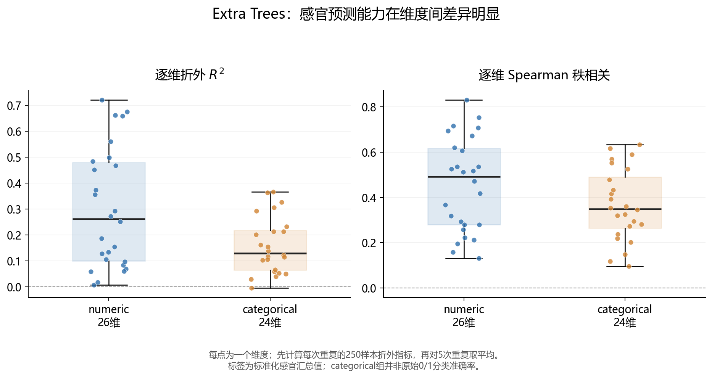

# Q1基线与逐维评价补充

日期：2026-10-25。直接读取既有Extra Trees折外预测及15次划分记录，没有重新训练预测器，没有搜索新超参数。

## 评价协议

5次重复、每次3折风格分层，每个重复内250款啤酒各取得一次折外预测。两个基线分别只使用对应训练折的全体均值、各风格均值预测。风格基线使用真实风格标签；每个测试风格均有训练样本，没有测试标签参与均值估计。

主表统一按“每次重复汇总全部250个折外预测，逐维评价，再跨维度和5次重复等权平均”的口径。此前消融主指标为15折MAE等权平均，因折大小为83/84而有极小差异；不是模型重训或效果变化。

目标仍为附件4的标准化感官汇总值。numeric/categorical仅按附件8的元数据分组，categorical组的回归指标不是原始0/1分类准确率；0—6映射不参与本次性能评价。

## 基线与主模型

| 方法 | 宏平均MAE↓ | 宏平均R²↑ | 宏平均Spearman↑ |
|---|---:|---:|---:|
| 训练折全体均值 | 0.417245 | −0.008005 | 不报告 |
| 训练折风格均值 | 0.358352 | 0.149788 | 0.354957 |
| 化学特征Extra Trees | 0.342816 | 0.232973 | 0.412407 |

相较全体均值，Extra Trees的宏平均MAE下降17.84%；相较风格均值，下降4.34%，宏平均R²增加0.0832。百分比是点估计，不自动代表统计显著。

### 相对风格基线的不确定性补充

读取同样15个划分的配对MAE，计算风格均值MAE减化学模型MAE，并采用与消融相同的Nadeau–Bengio方差修正。平均绝对改善0.015538，修正近似95%区间[0.006243,0.024833]。逐折先除以该折风格基线MAE再平均，相对改善4.32%，修正近似95%区间[1.75%,6.90%]。

逐折相对比例的平均4.32%与全体折外宏MAE之比4.34%是不同聚合方式，均保留明确口径；区间不直接贴到4.34%这个不同估计量上。它是既有结果上的补充性近似推断，不是独立确认实验，也不保证各风格或每一维都改善。

全体均值在每个测试折内预测为常数，其折内Spearman未定义。把不同折的不同常数混在一起会产生人为排名，因此不提供该基线的 pooled Spearman，也不以0填充。

风格基线已经有相当预测能力。当前结果支持“化学模型总体优于这一风格均值预测规则”，不能单独证明控制风格后的条件增量、因果贡献或风格内普遍有效；未进行“风格+化学vs风格”的新模型对照。

## 分类型结果

| 目标组 | 方法 | MAE↓ | R²↑ | Spearman↑ |
|---|---|---:|---:|---:|
| numeric，26维 | 全体均值 | 0.448251 | −0.007476 | — |
| numeric，26维 | 风格均值 | 0.363095 | 0.212027 | 0.394093 |
| numeric，26维 | Extra Trees | 0.346528 | 0.301026 | 0.455071 |
| categorical，24维 | 全体均值 | 0.383656 | −0.008578 | — |
| categorical，24维 | 风格均值 | 0.353214 | 0.082363 | 0.312559 |
| categorical，24维 | Extra Trees | 0.338794 | 0.159249 | 0.366187 |

较低的categorical组MAE不能直接解释为该类目标更容易预测：两组标签分布与变异程度不同。Spearman补充排序能力，但对大量并列值和稀疏分布也敏感，并非“对分布不敏感”的万能指标。

numeric与categorical的R²大小也不能脱离标准化和分布过程直接作为任务难度优劣的排序。本报告将分组统计用于描述预测表现，不作普遍可预测性结论。

## 逐维分布

先对每个维度的5次重复指标取平均，再在50个维度间求分位数。

| 组别 | R²第25百分位 | R²中位数 | R²第75百分位 | Spearman中位数 |
|---|---:|---:|---:|---:|
| 全50维 | 0.0870 | 0.1579 | 0.3481 | 0.3807 |
| numeric 26维 | 0.0994 | 0.2614 | 0.4801 | 0.4915 |
| categorical 24维 | 0.0643 | 0.1297 | 0.2179 | 0.3497 |

全体维度R²范围为−0.0049至0.7210。49维平均R²大于0，但大于0不等于达到实用精度。相较风格均值，43/50维MAE更低、48/50维R²更高；两项数量不同不矛盾，因为评价损失不同。

## 表现较好与较弱的维度

| 维度 | R² | Spearman | 相较风格基线的MAE下降 |
|---|---:|---:|---:|
| 酸度 acidity | 0.7210 | 0.5354 | 13.42% |
| 酒精感 alcohol | 0.6759 | 0.8308 | −3.29% |
| 醋酸感 acetic | 0.6618 | 0.3678 | 11.81% |
| 乳酸感 lactic | 0.6594 | 0.4715 | 4.76% |
| 苦感 bitternes | 0.5600 | 0.7531 | 4.07% |
| 花香风味 F_esters_flower | −0.0049 | 0.0959 | 4.86% |
| 陈旧酒花 stale_hops | 0.0065 | 0.1589 | −2.16% |
| 马厩/野性气味 barnyard | 0.0177 | 0.1959 | −3.94% |

正的MAE下降比例表示Extra Trees更好，负数表示更差。酒精感表明：绝对R²较高不意味着相较风格基线有增量优势。花香风味表明：优于一个较弱基线不等于自身预测可靠。酸度与醋酸感的R²和秩相关也不能互相替代，应结合分布解释。

完整逐维表新增MSE、风格基线MSE及skill=1−MSE模型/MSE风格。其中MSE先跨5次重复平均再计算比例。酒精感的MSE skill为−0.0571，酸度为0.3676：酒精感不仅MAE较差，平方误差也比风格基线高约5.71%。不能仅用训练损失与MAE不同来解释为“平方误差其实更好”。

按R²排序的五个最低维度是F_esters_flower、stale_hops、barnyard、A_esters_flower、A_malt_grain。完整50维和每次重复记录保存在同目录分析数据中。

## 对第三问的直接影响

| 缺陷感官维度 | R² | Spearman |
|---|---:|---:|
| DMS dms | 0.0584 | 0.2571 |
| 双乙酰 diacetyl | 0.0836 | 0.2931 |
| 4VG X4vg | 0.1538 | 0.5115 |
| t2n | 0.1061 | 0.2226 |
| Stale hops | 0.0065 | 0.1589 |

不能仅因化合物与某缺陷有名称对应就假定其感官评分模型准确。第三问在尺度与单位核实后优先检查直接化学浓度约束；上述模型输出只能补充描述，Stale hops尤其不能据预测宣称严格不恶化。

生成的感官画像可重点解读酸度、苦感等当前有较好证据的维度，风格真实感官均值作为独立对照。低可靠维度保留展示与明确标记，不为改善图形效果而隐藏。不根据本次逐维结果选择不同模型后继续复用同一评价分数声称无偏。

## 可用于论文的结果表述草稿

在5次重复三折风格分层验证中，基于化学特征的Extra Trees模型在50个标准化感官目标上的宏平均MAE为0.3428、宏平均R²为0.2330、宏平均Spearman相关系数为0.4124。相较训练折全体均值和风格均值基线，宏平均MAE分别降低17.84%和4.34%。模型预测能力在感官维度间差异明显：R²中位数为0.1579，酸度与苦感等维度表现较好，花香风味和陈旧酒花味的预测能力较弱。上述结果支持化学特征用于辅助感官刻画，但不足以将全部维度解释为准确的原始0—6分评分。

## 对上一轮区间结论的限定

下限指示消融的改善量修正近似95%区间上界为0.001191，低于以基线MAE点估计计算的1%门槛约0.003428。可写“在本次固定配置和近似区间分析下，区间上界未达到预设实用改善门槛”。不写成对所有划分、模型和总体均严格排除1%以上收益。
