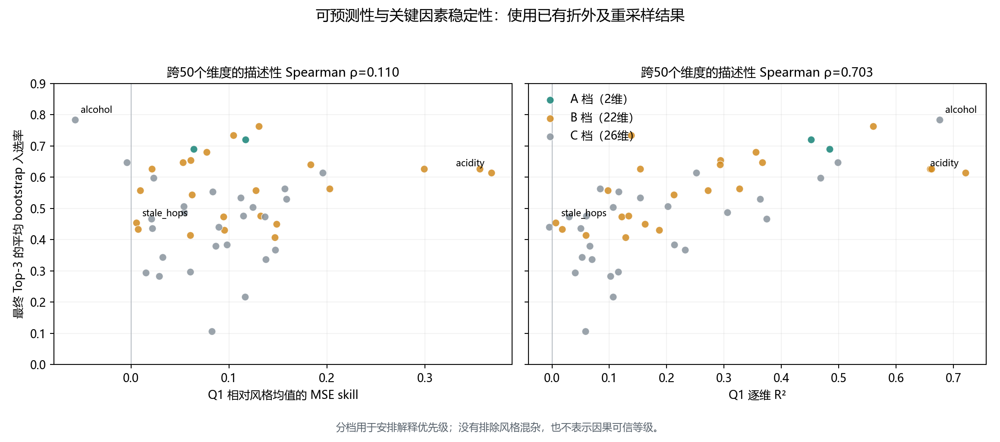

# Q2可靠性分档与已有结果补充

日期：2026-10-26。本次重训模型0个；没有重做bootstrap或风格残差化。

## 描述性分档规则

分档在已看到总体稳定性结果后制定，用于论文解释和人工核查的优先级，不称为预注册检验、显著性或因果证据。

- A：Q1相对风格均值MSE skill>0；最终三个候选平均置换重要性均为正；三个入选率均≥50%。可以重点报告稳定的模型关联，仍需化学核查。
- B：未入A；skill>0；最终候选涉及的至少一个非单点模块命中率≥70%。报告模块线索，不把整个Top-3当作稳定发现。
- C：其余目标。保留候选清单，但不据此下关键化学因素结论。

这些是描述门槛，不是客观置信度。大模块命中机会更高，模块命中不等于社区划分稳定；B不能解释为已经验证共线替换。

本次分档：A档2维、B档22维、C档26维。

跨50维的描述性Spearman：MSE skill对入选率=0.110，R²对入选率=0.703。维度彼此相关，不作50个独立重复的显著性检验；正相关也不能证明弱预测是低稳定性的唯一原因。

## 跨模型一致性

| Top-k | 化合物Jaccard中位数 | 模块Jaccard中位数 | 化合物均值 | 模块均值 |
|---|---:|---:|---:|---:|
| 3 | 0.000 | 0.200 | 0.122 | 0.171 |
| 5 | 0.111 | 0.225 | 0.108 | 0.214 |
| 10 | 0.111 | 0.223 | 0.133 | 0.213 |

比较对象为Extra Trees与8成分PLS，均按已有袋外置换MAE增量排序，在同一217个单体化学候选内截取Top-k。模块Jaccard先对各名单去重映射到固定模块，再求交并比。模块压缩与大模块本身会提高重叠，不能单独证实共线替换。

## 入选率的计算精度

100次重采样下，p=50%的二项Monte Carlo标准误约5个百分点。表中增加Wilson区间，仅近似描述给定数据和协议下重复100次的计算精度；不是未知真实化合物效应或总体入选率的置信区间。50%边界附近的A档应降格措辞。

## 逐维清单

| 目标 | 档 | Q1 skill | 平均入选率 | 最低入选率 | 非单点模块最高命中率 |
|---|---|---:|---:|---:|---:|
| aftertaste | A | 0.117 | 72.0% | 54.0% | 95.0% |
| F_hops_all | A | 0.064 | 69.0% | 51.0% | 81.0% |
| bitternes | B | 0.131 | 76.3% | 47.0% | 95.0% |
| F_hops_tropical | B | 0.105 | 73.3% | 45.0% | 89.0% |
| A_hops_all | B | 0.077 | 68.0% | 43.0% | 96.0% |
| A_hops_noble | B | 0.061 | 65.3% | 38.0% | 94.0% |
| F_hops_noble | B | 0.053 | 64.7% | 48.0% | 91.0% |
| co2 | B | 0.183 | 64.0% | 45.0% | 99.0% |
| F_hops_woody | B | 0.021 | 62.7% | 45.0% | 87.0% |
| lactic | B | 0.299 | 62.7% | 27.0% | 95.0% |
| acetic | B | 0.356 | 62.7% | 36.0% | 93.0% |
| acidity | B | 0.368 | 61.3% | 40.0% | 94.0% |
| F_malt_cara | B | 0.202 | 56.3% | 29.0% | 78.0% |
| F_esters_all | B | 0.127 | 55.7% | 48.0% | 96.0% |
| metallic | B | 0.010 | 55.7% | 38.0% | 70.0% |
| F_esters_ethac | B | 0.062 | 54.3% | 46.0% | 97.0% |
| overall | B | 0.132 | 47.7% | 38.0% | 82.0% |
| A_esters_ethac | B | 0.094 | 47.3% | 41.0% | 87.0% |
| stale_hops | B | 0.006 | 45.3% | 37.0% | 83.0% |
| A_hops_citrus | B | 0.148 | 45.0% | 36.0% | 71.0% |
| barnyard | B | 0.007 | 43.3% | 38.0% | 85.0% |
| A_esters_all | B | 0.095 | 43.0% | 39.0% | 91.0% |
| A_hops_woody | B | 0.061 | 41.3% | 19.0% | 80.0% |
| coriander | B | 0.147 | 40.7% | 34.0% | 86.0% |
| alcohol | C | -0.057 | 78.3% | 57.0% | 100.0% |
| body | C | -0.004 | 64.7% | 33.0% | 100.0% |
| sweetness | C | 0.196 | 61.3% | 32.0% | 67.0% |
| F_malt_all | C | 0.023 | 59.7% | 39.0% | 65.0% |
| diacetyl | C | 0.157 | 56.3% | 48.0% | 64.0% |
| A_hops_tropical | C | 0.084 | 55.3% | 12.0% | 66.0% |
| X4vg | C | 0.112 | 53.3% | 36.0% | 66.0% |
| F_malt_burn | C | 0.159 | 53.0% | 23.0% | 53.0% |
| F_hops_citrus | C | 0.054 | 50.7% | 41.0% | 61.0% |
| F_esters_isoaa | C | 0.125 | 50.3% | 33.0% | 66.0% |
| A_malt_cara | C | 0.054 | 48.7% | 26.0% | 63.0% |
| clove | C | 0.115 | 47.7% | 29.0% | 30.0% |
| A_esters_flower | C | 0.136 | 47.3% | 44.0% | 69.0% |
| A_malt_all | C | 0.021 | 46.7% | 29.0% | 43.0% |
| F_esters_flower | C | 0.089 | 44.0% | 24.0% | 57.0% |
| A_esters_fruity | C | 0.022 | 43.7% | 11.0% | 67.0% |
| F_malt_bread | C | 0.098 | 38.3% | 25.0% | 57.0% |
| A_esters_isoaa | C | 0.086 | 38.0% | 33.0% | 45.0% |
| A_malt_burn | C | 0.147 | 36.7% | 22.0% | 33.0% |
| F_malt_grain | C | 0.032 | 34.3% | 32.0% | 47.0% |
| orange | C | 0.137 | 33.7% | 25.0% | 52.0% |
| F_esters_fruity | C | 0.060 | 29.7% | 29.0% | 57.0% |
| A_malt_grain | C | 0.015 | 29.3% | 18.0% | 32.0% |
| A_malt_bread | C | 0.029 | 28.3% | 16.0% | 42.0% |
| t2n | C | 0.116 | 21.7% | 13.0% | 64.0% |
| dms | C | 0.082 | 10.7% | 8.0% | 16.0% |

## 尚未解决的混杂

尚未进行风格内置换、风格残差化或模块整体置换。酸度的乳酸候选与酚类候选须分开解释；酚类可能是发酵/风格共现标志物。A、B档也不能因此写成已经排除风格代理效应。酒精感虽R²高，但相对风格均值skill为负，按本规则不列入可强调的增量解释结论。
