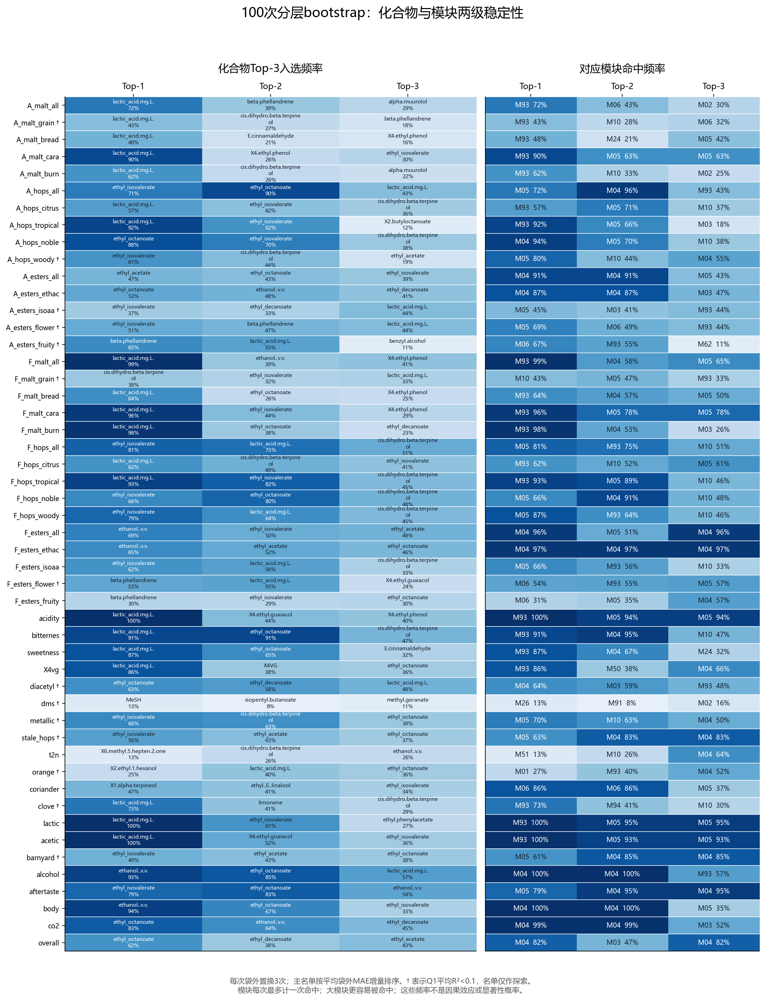

# Q2网络、关键化合物与稳定性：统计主流程结果

日期：2026-10-25。已完成100次分层bootstrap、每列3次袋外置换、Extra Trees与稳健PLS对照。本文给出统计候选和稳定性，尚不能替代逐项化学机理核查。

## 网络与名称核验

231个指标全部通过附件8名称映射，修复希腊字母的可逆乱码后，与附件2逐项对齐。对齐矩阵与附件1重算Spearman的最大差异为6.7e-16。没有使用附件6标签相关性筛选变量。

固定|rho|≥0.6阈值，得到231个节点、266条边（3条负相关边），Louvain划分为19个非单点模块与101个单点模块。101个孤立节点仍参与模型和统计，只为图的可读性未在左图绘制。阈值没有按输出结果调整。

网络仅用于描述和把每次名单映射到固定模块，不进入预测拟合。模块频率是固定划分下的名单命中率，并非模块划分本身在重采样中的稳定性。

## 评价方法

每次按22种风格分层有放回重采样250条训练记录，训练折中位数插补，未抽中的样本作为袋外评价集。两个模型使用同一重采样及同一置换顺序；置换重要性为MAE增加量，逐目标计算。保存全部训练/袋外编号，训练与袋外编号不交叉。

Extra Trees参数与Q1保持一致；对照为已有8成分稳健PLS。PLS是固定线性预测器，其置换预测以系数精确计算，并用显式置换预测校验；没有以系数大小冒充验证集置换重要性。

模型输入保留全部231列。主名单在217个单体化学候选中排序，排除14个派生、物理、混合或元素指标；完整因子Top-3另存supplementary_all_factor_top3.csv，不隐去模型对这些指标的依赖。

主名单按100次平均袋外置换MAE增量排序；入选频率是每次重拟合后进入前三的比例。模块每次最多命中一次。同模块可出现多个化合物，不强制分散；大模块命中机会较大。

逐列置换仍受共线性及不真实化学组合的影响，重采样不能自动消除这种偏差。重要性可以为负，不截断成零。重要性的2.5%和97.5%数值是重采样分布百分位，不称为因果效应置信区间。

## 稳定性概况

- 50个目标均输出3个候选，共150条主结果。
- 三个候选入选频率均不低于50%的目标：3/50。
- 三个候选入选频率均不低于60%的目标：0/50。
- 两模型最终Top-3的Jaccard中位数：0.000；均值：0.122。
- Q1平均R²低于0.1的目标：14/50，清单明确标记为探索性。

50%和60%仅作稳定性描述，不是显著性阈值。跨方法一致性与重采样稳定性不是同一件事，不因某个候选重复出现就把它称为真实驱动。

## 代表性目标

### acidity：Q1 R²=0.721，跨方法Jaccard=0.00

| 排名 | 化合物 | 袋外MAE增量 | 入选频率 | 模块 | 模块命中频率 |
|---|---|---:|---:|---|---:|
| 1 | Lactic acid | 0.08457 | 100% | M93 | 100% |
| 2 | 4-ethyl-guaiacol | 0.00666 | 44% | M05 | 94% |
| 3 | 4-ethyl-phenol | 0.00620 | 40% | M05 | 94% |

上表是模型关联候选，不能仅凭化合物名称判定直接感官机制。低预测目标尤其不能据此作干预保证。

### bitternes：Q1 R²=0.560，跨方法Jaccard=0.20

| 排名 | 化合物 | 袋外MAE增量 | 入选频率 | 模块 | 模块命中频率 |
|---|---|---:|---:|---|---:|
| 1 | Lactic acid | 0.02093 | 91% | M93 | 91% |
| 2 | Ethyl octanoate | 0.01521 | 91% | M04 | 95% |
| 3 | Cis-dihydro-β-terpineol | 0.01105 | 47% | M10 | 47% |

上表是模型关联候选，不能仅凭化合物名称判定直接感官机制。低预测目标尤其不能据此作干预保证。

### alcohol：Q1 R²=0.676，跨方法Jaccard=0.20

| 排名 | 化合物 | 袋外MAE增量 | 入选频率 | 模块 | 模块命中频率 |
|---|---|---:|---:|---|---:|
| 1 | Ethanol | 0.01982 | 93% | M04 | 100% |
| 2 | Ethyl octanoate | 0.01720 | 85% | M04 | 100% |
| 3 | Lactic acid | 0.01272 | 57% | M93 | 57% |

上表是模型关联候选，不能仅凭化合物名称判定直接感官机制。低预测目标尤其不能据此作干预保证。

### A_hops_citrus：Q1 R²=0.162，跨方法Jaccard=0.00

| 排名 | 化合物 | 袋外MAE增量 | 入选频率 | 模块 | 模块命中频率 |
|---|---|---:|---:|---|---:|
| 1 | Lactic acid | 0.00288 | 57% | M93 | 57% |
| 2 | Ethyl 3-methylbutyrate | 0.00195 | 42% | M05 | 71% |
| 3 | Cis-dihydro-β-terpineol | 0.00140 | 36% | M10 | 37% |

上表是模型关联候选，不能仅凭化合物名称判定直接感官机制。低预测目标尤其不能据此作干预保证。

### A_esters_isoaa：Q1 R²=0.066，跨方法Jaccard=0.00

| 排名 | 化合物 | 袋外MAE增量 | 入选频率 | 模块 | 模块命中频率 |
|---|---|---:|---:|---|---:|
| 1 | Ethyl 3-methylbutyrate | 0.00199 | 37% | M05 | 45% |
| 2 | Ethyl decanoate | 0.00141 | 33% | M03 | 41% |
| 3 | Lactic acid | 0.00128 | 44% | M93 | 44% |

上表是模型关联候选，不能仅凭化合物名称判定直接感官机制。低预测目标尤其不能据此作干预保证。

### diacetyl：Q1 R²=0.084，跨方法Jaccard=0.00

| 排名 | 化合物 | 袋外MAE增量 | 入选频率 | 模块 | 模块命中频率 |
|---|---|---:|---:|---|---:|
| 1 | Ethyl octanoate | 0.00447 | 63% | M04 | 64% |
| 2 | Ethyl decanoate | 0.00412 | 58% | M03 | 59% |
| 3 | Lactic acid | 0.00387 | 48% | M93 | 48% |

上表是模型关联候选，不能仅凭化合物名称判定直接感官机制。低预测目标尤其不能据此作干预保证。

### dms：Q1 R²=0.058，跨方法Jaccard=0.00

| 排名 | 化合物 | 袋外MAE增量 | 入选频率 | 模块 | 模块命中频率 |
|---|---|---:|---:|---|---:|
| 1 | Methanethiol | 0.00049 | 13% | M26 | 13% |
| 2 | Isopentyl butanoate | 0.00047 | 8% | M91 | 8% |
| 3 | Methyl geranate | 0.00045 | 11% | M02 | 16% |

上表是模型关联候选，不能仅凭化合物名称判定直接感官机制。低预测目标尤其不能据此作干预保证。

### X4vg：Q1 R²=0.154，跨方法Jaccard=0.20

| 排名 | 化合物 | 袋外MAE增量 | 入选频率 | 模块 | 模块命中频率 |
|---|---|---:|---:|---|---:|
| 1 | Lactic acid | 0.00767 | 86% | M93 | 86% |
| 2 | 4-vinylguaiacol | 0.00415 | 38% | M50 | 38% |
| 3 | Ethyl octanoate | 0.00325 | 36% | M04 | 66% |

上表是模型关联候选，不能仅凭化合物名称判定直接感官机制。低预测目标尤其不能据此作干预保证。

### t2n：Q1 R²=0.106，跨方法Jaccard=0.00

| 排名 | 化合物 | 袋外MAE增量 | 入选频率 | 模块 | 模块命中频率 |
|---|---|---:|---:|---|---:|
| 1 | Methyl heptenone | 0.00054 | 13% | M51 | 13% |
| 2 | Cis-dihydro-β-terpineol | 0.00048 | 26% | M10 | 26% |
| 3 | Ethanol | 0.00042 | 26% | M04 | 64% |

上表是模型关联候选，不能仅凭化合物名称判定直接感官机制。低预测目标尤其不能据此作干预保证。

### stale_hops：Q1 R²=0.006，跨方法Jaccard=0.00

| 排名 | 化合物 | 袋外MAE增量 | 入选频率 | 模块 | 模块命中频率 |
|---|---|---:|---:|---|---:|
| 1 | Ethyl 3-methylbutyrate | 0.00244 | 56% | M05 | 63% |
| 2 | Ethyl acetate | 0.00149 | 43% | M04 | 83% |
| 3 | Ethyl octanoate | 0.00131 | 37% | M04 | 83% |

上表是模型关联候选，不能仅凭化合物名称判定直接感官机制。低预测目标尤其不能据此作干预保证。

## 全50维主名单

| 感官目标 | Q1 R² | Top-1（入选率） | Top-2（入选率） | Top-3（入选率） | 最终Jaccard |
|---|---:|---|---|---|---:|
| A_malt_all | 0.374 | lactic_acid.mg.L.（72%） | beta.phellandrene（39%） | alpha.muurolol（29%） | 0.20 |
| A_malt_grain | 0.040 | lactic_acid.mg.L.（43%） | cis.dihydro.beta.terpineol（27%） | beta.phellandrene（18%） | 0.20 |
| A_malt_bread | 0.102 | lactic_acid.mg.L.（48%） | E.cinnamaldehyde（21%） | X4.ethyl.phenol（16%） | 0.00 |
| A_malt_cara | 0.305 | lactic_acid.mg.L.（90%） | X4.ethyl.phenol（26%） | ethyl_isovalerate（30%） | 0.00 |
| A_malt_burn | 0.232 | lactic_acid.mg.L.（62%） | cis.dihydro.beta.terpineol（26%） | alpha.muurolol（22%） | 0.00 |
| A_hops_all | 0.355 | ethyl_isovalerate（71%） | ethyl_octanoate（90%） | lactic_acid.mg.L.（43%） | 0.20 |
| A_hops_citrus | 0.162 | lactic_acid.mg.L.（57%） | ethyl_isovalerate（42%） | cis.dihydro.beta.terpineol（36%） | 0.00 |
| A_hops_tropical | 0.116 | lactic_acid.mg.L.（92%） | ethyl_isovalerate（62%） | X2.butyloctanoate（12%） | 0.00 |
| A_hops_noble | 0.293 | ethyl_octanoate（88%） | ethyl_isovalerate（70%） | cis.dihydro.beta.terpineol（38%） | 0.50 |
| A_hops_woody | 0.059 | ethyl_isovalerate（61%） | cis.dihydro.beta.terpineol（44%） | ethyl_acetate（19%） | 0.20 |
| A_esters_all | 0.187 | ethyl_acetate（47%） | ethyl_octanoate（43%） | ethyl_isovalerate（39%） | 0.20 |
| A_esters_ethac | 0.121 | ethyl_octanoate（53%） | ethanol..v.v.（48%） | ethyl_decanoate（41%） | 0.00 |
| A_esters_isoaa | 0.066 | ethyl_isovalerate（37%） | ethyl_decanoate（33%） | lactic_acid.mg.L.（44%） | 0.00 |
| A_esters_flower | 0.030 | ethyl_isovalerate（51%） | beta.phellandrene（47%） | lactic_acid.mg.L.（44%） | 0.20 |
| A_esters_fruity | 0.050 | beta.phellandrene（65%） | lactic_acid.mg.L.（55%） | benzyl.alcohol（11%） | 0.20 |
| F_malt_all | 0.468 | lactic_acid.mg.L.（99%） | ethanol..v.v.（39%） | X4.ethyl.phenol（41%） | 0.00 |
| F_malt_grain | 0.053 | cis.dihydro.beta.terpineol（38%） | ethyl_isovalerate（32%） | lactic_acid.mg.L.（33%） | 0.00 |
| F_malt_bread | 0.213 | lactic_acid.mg.L.（64%） | ethyl_octanoate（26%） | X4.ethyl.phenol（25%） | 0.00 |
| F_malt_cara | 0.327 | lactic_acid.mg.L.（96%） | ethyl_isovalerate（44%） | X4.ethyl.phenol（29%） | 0.00 |
| F_malt_burn | 0.363 | lactic_acid.mg.L.（98%） | ethyl_octanoate（38%） | ethyl_decanoate（23%） | 0.00 |
| F_hops_all | 0.484 | ethyl_isovalerate（81%） | lactic_acid.mg.L.（75%） | cis.dihydro.beta.terpineol（51%） | 0.50 |
| F_hops_citrus | 0.202 | lactic_acid.mg.L.（62%） | cis.dihydro.beta.terpineol（49%） | ethyl_isovalerate（41%） | 0.00 |
| F_hops_tropical | 0.138 | lactic_acid.mg.L.（93%） | ethyl_isovalerate（82%） | cis.dihydro.beta.terpineol（45%） | 0.00 |
| F_hops_noble | 0.366 | ethyl_isovalerate（66%） | ethyl_octanoate（80%） | cis.dihydro.beta.terpineol（48%） | 0.50 |
| F_hops_woody | 0.154 | ethyl_isovalerate（79%） | lactic_acid.mg.L.（64%） | cis.dihydro.beta.terpineol（45%） | 0.50 |
| F_esters_all | 0.272 | ethanol..v.v.（69%） | ethyl_isovalerate（50%） | ethyl_acetate（48%） | 0.20 |
| F_esters_ethac | 0.213 | ethanol..v.v.（65%） | ethyl_acetate（52%） | ethyl_octanoate（46%） | 0.00 |
| F_esters_isoaa | 0.106 | ethyl_isovalerate（62%） | lactic_acid.mg.L.（56%） | cis.dihydro.beta.terpineol（33%） | 0.00 |
| F_esters_flower | -0.005 | beta.phellandrene（53%） | lactic_acid.mg.L.（55%） | X4.ethyl.guaiacol（24%） | 0.20 |
| F_esters_fruity | 0.115 | beta.phellandrene（30%） | ethyl_isovalerate（29%） | ethyl_octanoate（30%） | 0.50 |
| acidity | 0.721 | lactic_acid.mg.L.（100%） | X4.ethyl.guaiacol（44%） | X4.ethyl.phenol（40%） | 0.00 |
| bitternes | 0.560 | lactic_acid.mg.L.（91%） | ethyl_octanoate（91%） | cis.dihydro.beta.terpineol（47%） | 0.20 |
| sweetness | 0.251 | lactic_acid.mg.L.（87%） | ethyl_octanoate（65%） | E.cinnamaldehyde（32%） | 0.00 |
| X4vg | 0.154 | lactic_acid.mg.L.（86%） | X4VG（38%） | ethyl_octanoate（36%） | 0.20 |
| diacetyl | 0.084 | ethyl_octanoate（63%） | ethyl_decanoate（58%） | lactic_acid.mg.L.（48%） | 0.00 |
| dms | 0.058 | MeSH（13%） | isopentyl.butanoate（8%） | methyl.geranate（11%） | 0.00 |
| metallic | 0.097 | ethyl_isovalerate（66%） | cis.dihydro.beta.terpineol（63%） | ethyl_octanoate（38%） | 0.20 |
| stale_hops | 0.006 | ethyl_isovalerate（56%） | ethyl_acetate（43%） | ethyl_octanoate（37%） | 0.00 |
| t2n | 0.106 | X6.methyl.5.hepten.2.one（13%） | cis.dihydro.beta.terpineol（26%） | ethanol..v.v.（26%） | 0.00 |
| orange | 0.069 | X2.ethyl.1.hexanol（25%） | lactic_acid.mg.L.（40%） | ethyl_octanoate（36%） | 0.20 |
| coriander | 0.128 | X1.alpha.terpineol（47%） | ethyl..E..linalool（41%） | ethyl_isovalerate（34%） | 0.00 |
| clove | 0.059 | lactic_acid.mg.L.（73%） | limonene（41%） | cis.dihydro.beta.terpineol（29%） | 0.20 |
| lactic | 0.659 | lactic_acid.mg.L.（100%） | ethyl_isovalerate（61%） | ethyl.phenylacetate（27%） | 0.00 |
| acetic | 0.662 | lactic_acid.mg.L.（100%） | X4.ethyl.guaiacol（52%） | ethyl_isovalerate（36%） | 0.00 |
| barnyard | 0.018 | ethyl_isovalerate（49%） | ethyl_acetate（43%） | ethyl_octanoate（38%） | 0.00 |
| alcohol | 0.676 | ethanol..v.v.（93%） | ethyl_octanoate（85%） | lactic_acid.mg.L.（57%） | 0.20 |
| aftertaste | 0.452 | ethyl_isovalerate（79%） | ethyl_octanoate（83%） | ethanol..v.v.（54%） | 0.20 |
| body | 0.498 | ethanol..v.v.（94%） | ethyl_octanoate（67%） | ethyl_isovalerate（33%） | 0.20 |
| co2 | 0.293 | ethyl_octanoate（83%） | ethanol..v.v.（64%） | ethyl_decanoate（45%） | 0.00 |
| overall | 0.134 | ethyl_octanoate（62%） | ethyl_decanoate（38%） | ethyl_acetate（43%） | 0.20 |

## 对下一阶段的约束

酸度提供了一个有用的两级稳定性例子：乳酸入选100%；4-ethylguaiacol与4-ethylphenol分别入选44%和40%，两者均在M05，其模块命中率94%。附件8将这些候选来源标为Wild flora。这支持“同一微生物相关化学模块内存在替代变量”的解释，但不能把酚类标记物直接解释为产生酸味的因果化合物。

全因子辅助排名必须与化合物主表并列说明。例如酸度的全因子前三为乳酸、总酸与pH，后两者不属于主表的单体候选；酒精感的全因子前三包含热量这一派生指标。不展示这些信息会掩盖预测器的实际依赖。DMS的全因子前三也不是DMS本身，结合其低Q1表现，更不能声称发现了可靠的DMS感知机理。

保留低稳定性或低预测可靠性目标，明确其探索性，不为得到更好数字追加模型、重选图阈值或重抽随机种子。未做的组置换、SHAP和图阈值敏感性不写成已经验证。
第三问只能把稳定名单作为候选化学关系与模块约束的辅助，不能把置换重要性当成因果导数。DMS等缺陷仍优先使用真实单位浓度阈值，Stale hops的弱感官代理不能构成严格保证。

本次统计完成后，下一步按较高预测可靠性目标和实际Top-3逐项核对化学作用、单位及阈值；尚未完成的机理文献核查不得写作已证实。
