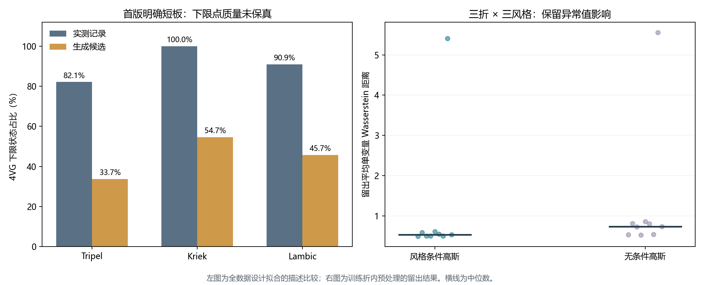
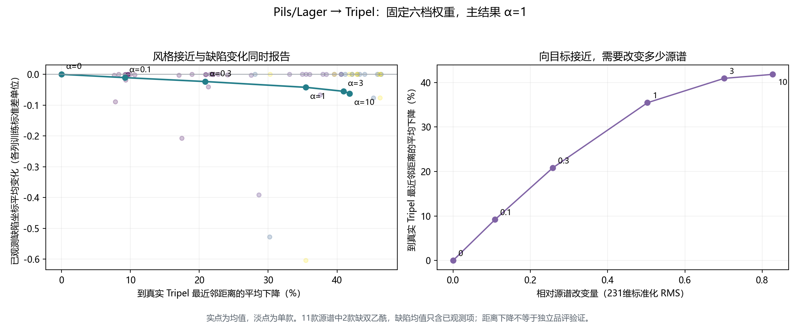
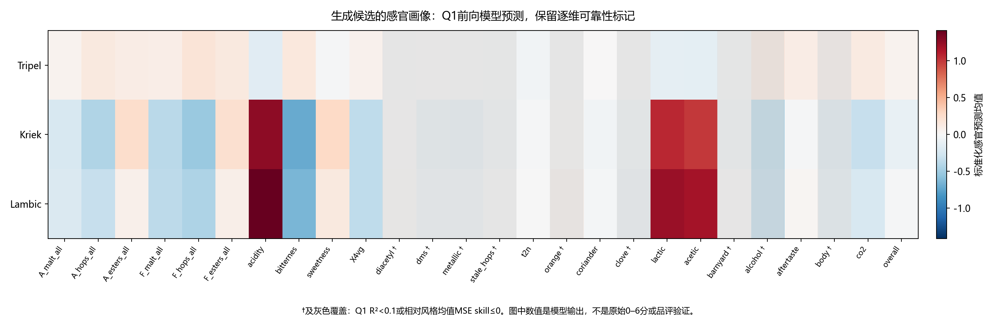

# Q3收缩高斯与约束迁移：首版结果

日期：2026-10-26。已跑通生成、留出保真评价、跨风格迁移、缺陷验收及感官画像。首版约束可运行，但生成分布仍有明显不足，不能宣称所有保真检验通过。

## 已实现方法与输出

231维储存坐标训练集内中位数插补、标准化，按风格拟合Ledoit–Wolf收缩高斯；样本投影到训练观测范围。Tripel、Kriek、Lambic各300个，共900个候选。另输出217个单体化学候选字段，去除Q2定义的14个理化/派生/混合指标。

它是固定参数的最小基线，没有潜变量维数选择、GAN或CVAE。完整231维包含派生指标，但未施加派生指标恒等式、化学计量或酿造工艺约束，因此交付是候选特征谱，不能称为生产配方。

## 阈值与下限补充

| 缺陷 | 按附件8主阈值超出/有效数 | 比例 |
|---|---:|---:|
| DMS | 156/250 | 62.4% |
| Diacetyl | 172/250 | 68.8% |
| 4VG | 18/250 | 7.2% |
| t2n | 248/249 | 99.6% |

这些是附件记录和标注单位下的条件性计数。双乙酰校准零值不等于真实零；t2n尺度疑点未解决，不擅自作1000倍修正。附件阈值只提供一行均值/中位数汇总，底层记录数量和介质不详，不编造为“n次啤酒试验的中位数”。

4VG下限状态168/250=67.2%，CS2最小值209/250=83.6%。迁移中9/11款源谱4VG处于下限，候选强制不高于相同替代下限，不能解释为精确浓度不增加。没有测量误差依据，不额外添加测量容差。

## 风格条件生成的留出保真

三折风格分层；所有预处理、观测范围和高斯参数只来自训练折。对三个目标风格分别评价，以9个“折×风格”单元等权汇总。无条件高斯作为比较，共用标准正态随机数。

| 指标（越小越好） | 风格条件高斯 | 无条件高斯 |
|---|---:|---:|
| 标准化逐坐标均值误差 | 0.9160 | 1.0593 |
| 平均单变量Wasserstein | 1.0778 | 1.2343 |
| 去风格中心相关矩阵RMSE | 0.3232 | 0.3031 |

风格条件化使前两项分别下降13.5%和12.7%，但相关结构没有优于无条件基线。因此只能说风格中心与边际分布有所改善，不能说联合结构已得到充分保真。小风格留出只有3—4条，相关指标本身也很不稳定。

第四项为到同风格训练样本的最近邻距离。保存了生成/真实留出各自距离及比值，不设置事后通过线。生成训练样本精确复制数为0，仅能排除精确复制，不能证明没有近邻依赖或模式收缩。

训练折尺度诊断发现个别留出值可达训练标准差的约475倍或3330倍，宏观均值会受其影响。没有删掉这些样本或按测试表现改缩放；同时保留均值、中位数、逐折表及诊断字段。

| 风格 | 实测4VG下限占比 | 生成4VG下限占比 | 范围投影的坐标占比 |
|---|---:|---:|---:|
| Tripel | 82.1% | 33.7% | 14.6% |
| Kriek | 100.0% | 54.7% | 15.8% |
| Lambic | 90.9% | 45.7% | 15.0% |

高斯模型不能重现大量重复下限形成的点质量。这里的实测与生成占比是全数据拟合的描述比较，仍足以暴露问题。范围投影较多也说明矩形范围约束不足以恢复真实联合分布。

## Pils/Lager → Tripel迁移

在标准化坐标z中，最小化 0.5||z−z₀||²+0.5α(z−μ_T)ᵀΣ_T⁻¹(z−μ_T)，同时限制训练观测范围及四项缺陷上界。采用L-BFGS-B求解此有界凸二次问题，再在原储存坐标最终投影。α固定为0、0.1、0.3、1、3、10；主结果预先指定α=1，不按效果挑权重。

共11款源谱×6档权重=66个结果，优化均成功。主权重下，到目标高斯的Mahalanobis距离平均下降56.6%；到真实Tripel的最近邻标准化距离平均下降35.5%。前一距离直接参与目标，后一距离虽不是优化项，仍只是在同一数据几何空间内的接近度，不能替代独立风格品评。

- 9/11款源谱四项字段齐全，9/9在主权重下通过四项同尺度非增；涉及下限的项目另标记为下限状态保持。
- beer 119、28缺少源双乙酰，2款只验证其余已观测项，四项全部通过状态为不可完整验收。
- 主权重下四项同时低于主工作阈值：0/9。浓度非增不等于达标；t2n阈值情景单独保存。
- 所有66个候选已观测缺陷都不增加；9个源4VG下限状态在全部权重下均保持。
- 没有任何候选被认证为五项缺陷感官不恶化；Stale hops没有异戊酸测量，现有乳酸/乙酸不新增为特异代理。

图同时展示风格接近、缺陷变化和源谱改变量，因此不能通过把缺陷压低而忽略目标风格。它是设计权重扫描，不称为已求得全局Pareto前沿。

| α | 到真实Tripel最近邻距离平均下降 | 源谱改变量RMS | 已观测缺陷坐标平均变化 |
|---|---:|---:|---:|
| 0 | 0.0% | 0.000 | -0.0000 |
| 0.1 | 9.2% | 0.109 | -0.0106 |
| 0.3 | 20.8% | 0.258 | -0.0233 |
| 1 | 35.5% | 0.503 | -0.0421 |
| 3 | 40.9% | 0.701 | -0.0550 |
| 10 | 41.8% | 0.827 | -0.0619 |

缺陷平均变化以各列训练标准差归一化，缺失项不纳入；不是把不同mg/L量纲直接相加，也不是新的缺陷感官总分。逐项原值/替代浓度与质量标志见验收表。

## 感官画像与可靠性

固定Q1 Extra Trees参数在全体实测样本上拟合最终前向模型，给生成与迁移谱输出50维标准化感官预测。逐项附原Q1折外R²和相对风格均值MSE skill；候选间分位数不称为预测置信区间。

酒精感虽R²高但相对风格均值skill<0，灰色标记；Stale hops也保留低可靠性标记，不能参与严格缺陷保证。这次不将新候选的标准化模型输出伪称为真实0–6评分。

## 首版判断与下一步取舍

首版完整跑通，可供论文报告方法、约束与权衡。保真仍存在明确问题：重复下限的点质量、训练尺度对稀有极端值敏感、相关结构未胜无条件基线、派生量恒等式未施加。不能把900条输出直接称为900条验证通过的合理化学谱。

暂不升级到CVAE、GAN或更复杂潜变量模型。若继续改进，优先考虑保留重复下限质量的边际映射及已知派生关系，属于针对数据结构的修正；需要另记协议并与首版同折比较，不回写本次预设协议。

Q2可靠性分档、可预测性关联图和宽松Jaccard已用保存结果完成，没有重训主模型。风格混杂仍未排除，不把相关性写成因果。

## 复现与文件

依次运行supplement_threshold_audit.py、run_gaussian_baseline.py、render_baseline_report.py；Q2补充运行supplement_reliability.py。建模运行环境Python3.9、NumPy、Pandas、SciPy、scikit-learn、Matplotlib、joblib，具体版本另存environment_versions.json。CSV为数据与统计中间输出，原始附件未改动。
