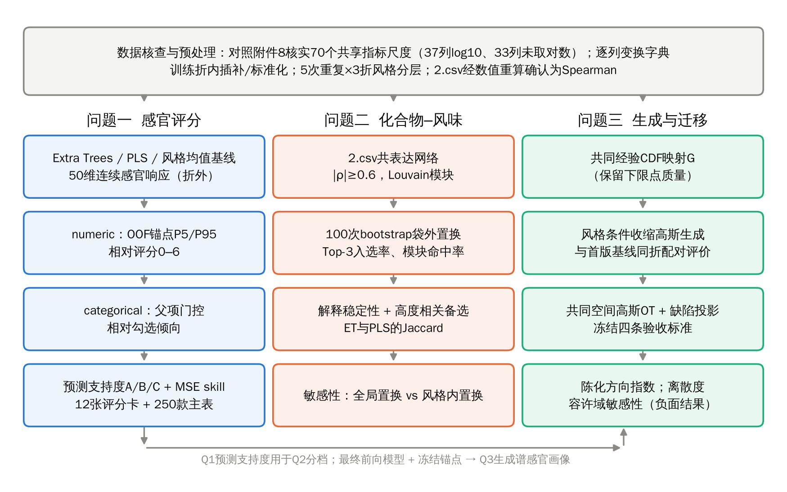
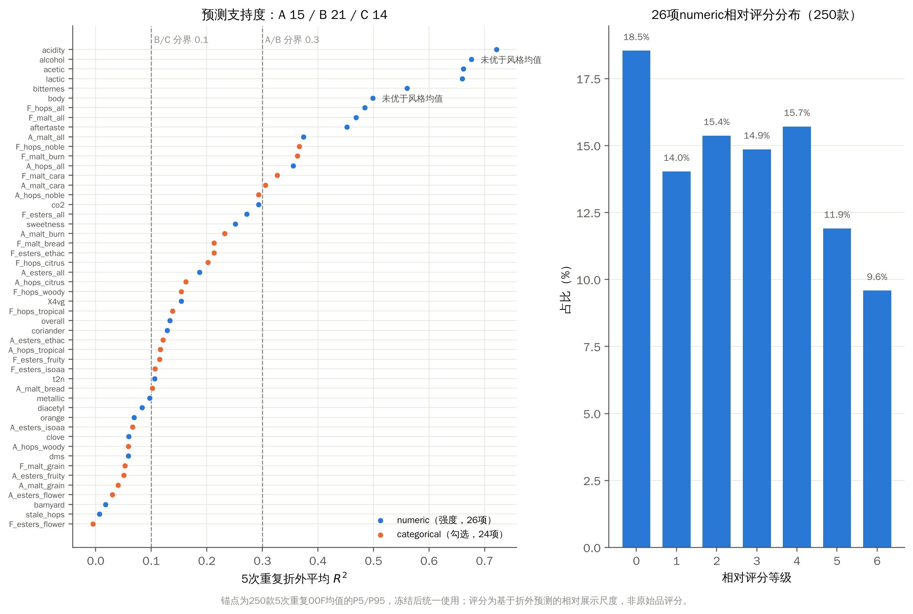
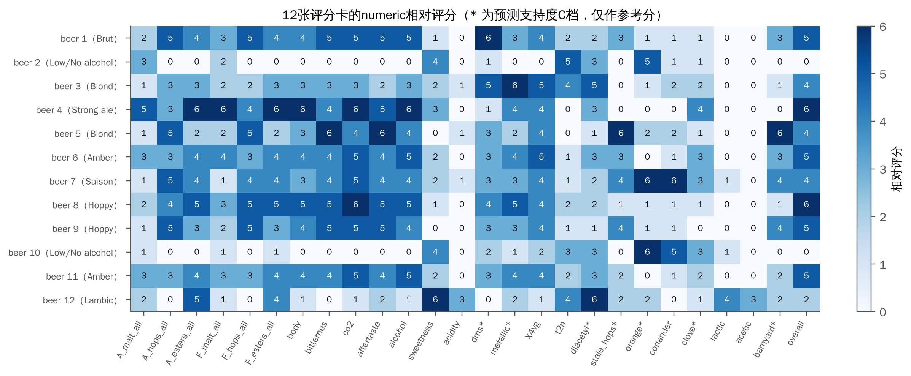
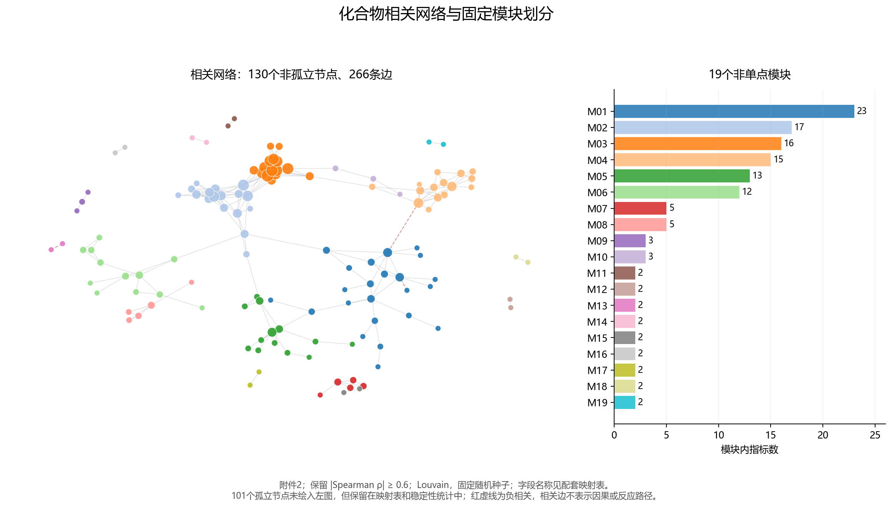
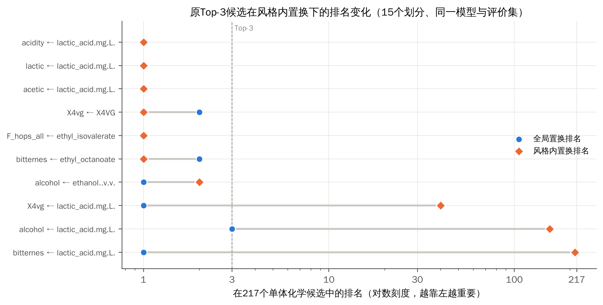
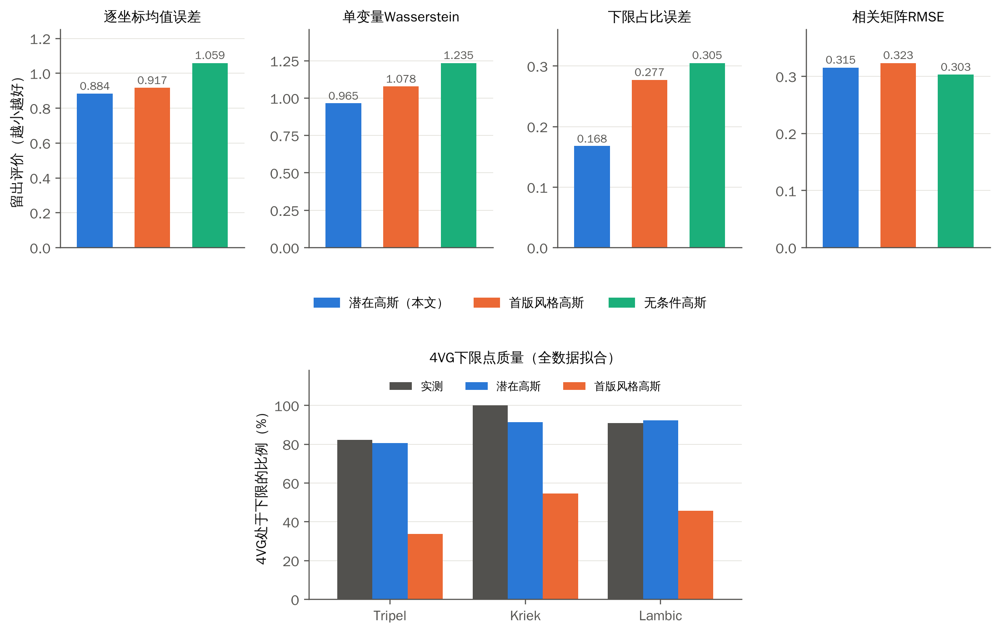
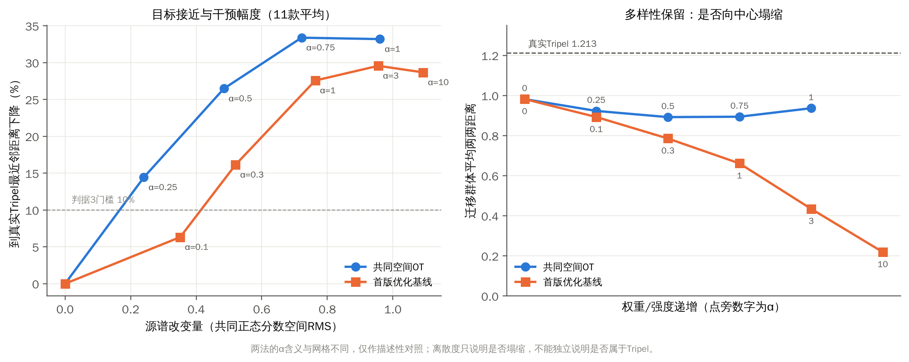

# 一、问题重述

## 1.1 问题背景

啤酒以麦芽、水、酒花为主要原料经酵母发酵酿成，其风味由数百种化合物共同决定：酒花带来的萜类化合物贡献草本与果香，酵母代谢产生的酯类与高级醇带来果香与溶剂感，麦芽美拉德产物、野生菌群代谢物以及陈化产物则构成麦芽、酸味和老化风味；二甲基硫（DMS）、双乙酰、4-乙烯基愈创木酚（4VG）、反-2-壬烯醛（t2n）等超阈值时会形成缺陷风味。如何从化学测量出发刻画感官、识别关键化合物并在给定风格下设计合理的化合物谱，是数据驱动酿造的核心问题。

附件给出 250 款商用啤酒的化学特性（附件 1，231 个指标）、化合物间相关矩阵（附件 2）、感官评分卡模板（附件 3）、标准化感官评分（附件 4，50 个属性）、感官间及化学—感官交叉相关（附件 5、6）、论坛评论描述符（附件 7）与阈值、校准等参考数据（附件 8）。数据含真实缺失与异常值。

## 1.2 问题重述

**问题一**：以附件 1 化合物数据为基础，给出附件 3 定义的 Aroma 与 Flavour 等感官维度的 0–6 分级评分。

**问题二**：利用附件 2 构建化合物共表达图，结合附件 1，给出每个感官维度的 Top-3 关键化合物，并用 bootstrap 入选频率或方法间 Jaccard 系数论证稳定性与化学合理性。

**问题三**：以 `tasting_category_fine` 为风格标签学习风格条件生成模型，在给定风格（Tripel、Kriek、Lambic）下生成合理的化合物谱及其感官画像；并把 Pils/Lager 的化合物谱迁移为 Tripel 风格，且保持缺陷化合物不恶化。

# 二、问题分析

## 2.1 数据层面的关键事实

（1）**尺度不统一。** 题面称化合物列经对数变换、理化参数保留原始量纲。本文用附件 8「Calibrated chemical dataset」逐列比对 70 个共享指标，发现 37 列满足“附件 1 值 = log10(原始浓度)”，其中包括 ethanol、pH、color、bitterness、CO₂ 等理化参数；另 33 列（如 2,3-丁二酮、芳樟醇、t2n、β-大马酮）未取对数。这一结论只覆盖共享指标，其余列逐列登记在变换字典中，已取对数的列不重复取对数。

（2）**感官标签不是原始评分。** 附件 4 的 50 列中多数有 200–250 个不同取值，观测最小值处没有质量堆积，不支持“单个离散 0–6 分经统一仿射标准化”的解释，更可能是品评小组多人汇总后的标准化值。由于汇总机制未知，原始 0–6 分无法唯一反推。

（3）**评分类型分两类。** 附件 8「Sensory names」显示 50 项中 26 项为 numeric（强度），24 项为 categorical（勾选）。Aroma 与 Flavour 的 30 项实际是 6 项父项强度（malt/hops/esters 的 overall）加 24 项子项勾选；模板中子项展示值由公式“父项强度×勾选”给出。

（4）**样本与风格。** 附件 1 实际为 250 个样本（题面为 226），分属 22 种风格，最少的 Faro 仅 3 款、Brut 4 款，交叉验证必须按风格分层。

## 2.2 问题一的分析

问题一的“数据缺失”包含两层：化合物输入存在 73 个真实 NA；同时只有标准化感官值而缺少原始 0–6 评分尺度。因此本文分两步：先在交叉验证中预测连续感官响应并报告标准化尺度上的精度；再以声明的约定把连续预测映射为 0–6 的相对评分，用于填写评分卡。映射只是交付展示尺度，不冒充恢复了原始评分，也不参与模型选择。

## 2.3 问题二的分析

“关键化合物”需要同时回答三个问题：模型是否真的依赖它（重要性）、换一批样本是否仍然选中它（稳定性）、它是否可能只是风格的代理（混杂）。共表达网络的作用是把高度相关的化合物组织为模块，用于报告“模块线索”与“高度相关备选”，避免把共线化合物之间的偶然排序当作化学结论。

## 2.4 问题三的分析

化学谱有两个难点：一是大量化合物处于检出下限（如 4VG 下限占比 67.2%），普通高斯模型无法复现这种点质量；二是每个风格样本很少（Tripel 28 款、Pils/Lager 11 款），而维度高达 231。因此生成器需在边际上保留下限点质量，在联合结构上用收缩估计。迁移需要同时满足三类要求：接近目标风格、尽量少改动源谱、缺陷不恶化。本文以“共同正态分数空间 + 闭式高斯最优传输 + 缺陷非增投影”实现，并在运行前冻结验收标准。

全文技术路线如图 1 所示。

{width=95%}

# 三、模型假设

（1）附件 1 中同一列在不同样本间的测量与校准流程一致；检出下限处的重复值表示“未检出或低于下限”的状态，而非精确的零浓度。

（2）附件 4 的标准化感官值在样本间可比，可作为连续回归目标；其背后的原始 0–6 评分尺度未知，本文的 0–6 评分只是相对展示尺度。

（3）250 款啤酒可视为同一总体的样本，按风格分层的交叉验证能够近似评价模型在同类啤酒上的泛化能力。

（4）同一风格内的化合物谱近似服从“经边际经验分布变换后的多元正态分布”；风格间差异主要体现在均值与协方差上。

（5）缺陷“不恶化”以同一储存尺度上的浓度非增为主判据；阈值仅用于辅助解释。Stale hops 缺少对应的化学测量，只能用代理指标说明。

# 四、符号说明

| 符号 | 含义 |
|:--:|:--|
| $x_i\in\mathbb R^{231}$ | 第 $i$ 款啤酒的化学谱（附件 1 储存尺度） |
| $y_{ij}$ | 第 $i$ 款啤酒第 $j$ 个感官属性的标准化值（附件 4） |
| $\hat z_{ij}$ | 第 $j$ 个属性的折外预测值（5 次重复平均） |
| $q^{\mathrm{OOF}}_{0.05,j},\,q^{\mathrm{OOF}}_{0.95,j}$ | 250 款折外预测的第 5、95 百分位（冻结锚点） |
| $s_{ij}$ | numeric 属性的相对评分（0–6） |
| $b_{ij}$ | categorical 属性的勾选结果（0/1） |
| $R^2_j$ | 第 $j$ 维 5 次重复折外平均决定系数 |
| $I^{\mathrm{glob}}_{jk},\,I^{\mathrm{within}}_{jk}$ | 化合物 $k$ 对属性 $j$ 的全局 / 风格内置换重要性 |
| $G$ | 逐列经验 CDF 构成的共同映射，$z=G(x)$ |
| $\mu_s,\Sigma_s;\ \mu_t,\Sigma_t$ | 源（Pils/Lager）/ 目标（Tripel）风格在共同空间中的均值与收缩协方差 |
| $T(\cdot)$ | 高斯最优传输映射 |
| $\alpha$ | 迁移强度 |
| $A(x)$ | 陈化方向指数 |
| $d(\cdot,\cdot)$ | 共同正态分数空间中按 $\sqrt{p}$ 归一化的欧氏距离，$p=231$ |

# 五、数据预处理

## 5.1 尺度核查与变换字典

对附件 8 校准数据中与附件 1 共享的 70 个指标，逐列比较附件 1 值 $v$ 与校准浓度 $c$：若中位绝对差 $\mathrm{med}|v-\log_{10}c|<10^{-3}$ 则判为 log10 列，若 $\mathrm{med}|v-c|<10^{-6}$ 则判为原值列。结果为 37 列 log10、33 列原值、无其他情况。负值对应原始浓度小于 1。核查结果记入逐列变换字典，未能核实的列不作变换假设。

附件 2 的相关矩阵经映射到附件 1 字段后，与附件 1 数据重算的 Spearman 相关系数最大差小于 $10^{-12}$，确认为 Spearman 相关（题面称 Pearson，以数值核验为准）。

## 5.2 缺失、下限与异常值

附件 1 共 73 个缺失值，集中在 amyl acetate（27）、methylpyrazine（12）、2,3-丁二酮（9）、3-甲基丁醛（7）等列。缺失值在每个训练折内用中位数插补，测试折使用训练折的插补值。大量列存在重复的最小值（如 4VG 下限 168/250），本文将其视为“下限状态”，在问题三中专门保留。

对极端值不做全局缩尾：缩尾会改动缺陷化合物的源测量值，使问题三的“不恶化”失去依据。树模型对单调变换和极端值不敏感，PLS 则在训练折内使用分位数正态化。

## 5.3 验证协议

所有预测评价采用 5 次重复、每次 3 折、按风格分层的交叉验证（Faro 仅 3 款，3 折与分层兼容），共 15 个划分；插补、标准化、分位数变换均只在训练折拟合。比较两种方法时使用同一组划分，配对差值的区间采用 Nadeau–Bengio 方差修正 [6]。

# 六、问题一：数据缺失条件下的感官评分

## 6.1 连续感官响应预测

以附件 1 的 231 维化学谱为输入、附件 4 的 50 维标准化感官值为输出，比较三种方法：训练折全体均值、训练折风格均值（使用真实风格标签），以及多输出 Extra Trees [2]（160 棵树，min_samples_leaf=3，max_features=0.7，固定参数，不做模型搜索）。另以 8 成分 PLS 回归 [10] 作为线性对照。结果见表 1。

表 1 问题一连续感官预测的折外结果（5 次重复×3 折）

| 方法 | 宏平均 MAE↓ | 宏平均 R²↑ | 宏平均 Spearman↑ |
|:--|--:|--:|--:|
| 训练折全体均值 | 0.4172 | −0.0080 | — |
| 训练折风格均值 | 0.3584 | 0.1498 | 0.3550 |
| Extra Trees | **0.3428** | **0.2330** | **0.4124** |

Extra Trees 相较全体均值宏平均 MAE 下降 17.84%，相较风格均值下降 4.34%。逐折计算“风格均值 MAE − 模型 MAE”，经 Nadeau–Bengio 修正，平均相对改善 4.32%，近似 95% 区间为 [1.75%, 6.90%]。这说明化学特征在风格信息之外提供了稳定但有限的增量。按类型分组，numeric 26 维 R² 为 0.301，categorical 24 维为 0.159。

此外，在训练折下限位置增加“是否处于下限”的指示变量的消融实验中，宏平均 MAE 由 0.342834 变为 0.343579，修正区间 [−0.0027, 0.0012] 未达到预设的 1% 改善门槛，因此保留原特征模型。

预测能力在维度间差异明显（图 2）：酸度（R²=0.721）、醋酸感（0.662）、乳酸感（0.659）、苦感（0.560）预测较好；花香风味、陈旧酒花、马厩味的 R² 接近 0。酒精感 R² 为 0.676，但相对风格均值的 MSE skill 为 −0.057，即其高 R² 主要来自风格差异。

{width=88%}

**缺失鲁棒性。** 在自然缺失之外再随机遮蔽 10% 已观测特征（训练折内插补），Extra Trees 全 50 维平均 R² 由 0.224 降至 0.207（单次三折），PLS 基本不变（0.165）。这表示中等程度的随机缺失下性能变化有限；单次随机遮蔽不能代表所有缺失机制，尤其不能推广到整类化合物不可测的情形。

## 6.2 预测支持度分档

为使后续交付与解释有据可依，按 5 次重复折外平均 $R^2_j$ 将 50 维统一分档：

$$
\text{A 档}: R^2_j\ge 0.3;\qquad \text{B 档}: 0.1\le R^2_j<0.3;\qquad \text{C 档}: R^2_j<0.1 .
$$

另单列“相对风格均值的 MSE skill 是否为正”：$\mathrm{skill}_j=1-\mathrm{MSE}_j^{\text{模型}}/\mathrm{MSE}_j^{\text{风格均值}}$。分档结果为 A 档 15 项、B 档 21 项、C 档 14 项（numeric 11/8/7，categorical 4/13/7）；酒精感与酒体虽在 A 档，但 skill≤0，标注“未优于风格均值”。分档称为“预测支持度”，是对预测证据强弱的描述，不是统计置信度。五个缺陷感官维度中 dms、diacetyl、stale_hops 位于 C 档，X4vg、t2n 位于 B 档。

## 6.3 numeric 属性：基于折外预测的相对评分

回归预测必然向均值收缩，若直接用真实标签分位数作锚点，几乎没有样本能得到 5、6 分。本文用折外预测自身的分布作参考：取每款啤酒 5 次重复折外预测的均值 $\hat z_{ij}$（每款只占一个位置），对每个 numeric 属性计算 250 个参考值的第 5、95 百分位并冻结：

$$
s_{ij}=\operatorname{round}\left[\operatorname{clip}\left(6\cdot\frac{\hat z_{ij}-q^{\mathrm{OOF}}_{0.05,j}}{q^{\mathrm{OOF}}_{0.95,j}-q^{\mathrm{OOF}}_{0.05,j}},\,0,\,6\right)\right].
$$

12 张评分卡、250 款主表以及问题三生成谱均使用同一套锚点，不按风格重新拉伸；26 个属性均满足 $q_{0.05}<q_{0.95}$。0 分表示“按本方案定义的相对低强度”，不表示未检出。这一映射只改变展示尺度，不增加预测信息，也不参与模型选择；标准化尺度上的 R²、MAE 不受影响。

## 6.4 categorical 属性：父项门控的相对勾选倾向

标准化的勾选汇总值无法恢复原始勾选人数比例，故本文输出“相对勾选倾向”，并按约定规则给出勾选结果：

$$
b_{ij}=\mathbf 1\left(s_{i,\mathrm{parent}(j)}>0\right)\cdot\mathbf 1\left(\hat z_{ij}>\bar y_{j}^{\,\mathrm{train}}\right),
$$

其中 $\bar y_j^{\,\mathrm{train}}$ 为该款啤酒作为测试样本时 5 个对应训练折真实均值的平均，保证严格折外；父项为同组 overall 强度（如 A_malt_grain 的父项为 A_malt_all）。模板展示值 = 父项强度 × 勾选结果，与模板公式一致。父项门控后各属性最终勾选率为 29.2%–58.4%，中位数 44.2%。

图 3 左为 50 维的预测支持度，右为 26 项 numeric 相对评分在 250 款中的分布（0 分 18.5%，1–5 分各 12%–16%，6 分 9.6%）。

{width=95%}

## 6.5 评分卡填写结果

附件 3 实际包含 beer_1–beer_12 共 12 张评分卡及 summary 表。按每张表 Beer# 单元格与样本 `beer` 编号匹配（不取数据前 12 行），250 款主表使用折外预测，强度在 0–6 对应格标记，勾选在勾选格标记，由模板原公式计算分数。核对中发现模板 summary 表 barnyard 列（AX）误引用了 Stale hops 单元格 `$AG$76`，本文在填写副本中改为 `$AG$90`；经 LibreOffice 重算，summary 表与程序计算值逐格一致。评分卡上的 Acetaldehyde 一行在附件 4 中无对应目标，予以留空。

图 4 给出 12 款啤酒 26 项 numeric 的相对评分。结果与风格常识一致：Lambic（beer 12）酸度、乳酸感、醋酸感最高；两款低/无醇啤酒（beer 2、10）的酒精、酒体、苦感为 0，橙皮评分较高；Strong ale（beer 4）的麦芽、酯香、酒精与总体评价均较高。带“*”的 C 档属性只作参考分。

{width=100%}

# 七、问题二：化合物–风味分析

## 7.1 化合物共表达网络

将附件 2 的 231×231 Spearman 相关矩阵中 $|\rho|\ge 0.6$ 的化合物对连边，得到 266 条边、130 个非孤立节点；以 Louvain 算法 [5]（固定随机种子）划分社区，得到 19 个非单点模块（最大模块 23 个指标）与 101 个单点（图 5）。去除 14 个理化、派生或混合指标（如 pH、色度、kcalperc、esters_sum）后，217 个单体化学指标作为候选。

{width=92%}

## 7.2 Top-3 关键化合物与稳定性

对 250 款啤酒做 100 次按风格分层的有放回抽样。每次在 bootstrap 样本上拟合 Extra Trees 与 PLS，在袋外样本上逐列置换（各 3 次）并记录 50 维 MAE 增量作为重要性 [3]。每个感官维度以 100 次平均重要性排序取 Top-3，并统计：

- **入选率**：某化合物在 100 次中进入 Top-3 的比例，并给出 Wilson 区间描述 Monte Carlo 精度；
- **模块命中率**：某模块至少有一个化合物进入 Top-3 的比例；
- **方法间 Jaccard 系数**：$J=|A\cap B|/|A\cup B|$，比较 Extra Trees 与 PLS 的 Top-k 名单。

Top-3 层面，化合物 Jaccard 中位数为 0.000、模块 Jaccard 中位数为 0.200；Top-10 时分别为 0.111 与 0.223。两种模型在单体层面很少一致，在模块层面一致性略高，说明共线化合物之间的排序本身不稳定。图 6 给出 50 维 Top-3 的入选率与对应模块命中率。

{width=88%}

## 7.3 两维分档：预测支持度 × 解释稳定性

Top-3 只有在模型能预测该维度时才有意义，因此把 6.2 节的预测支持度与解释稳定性交叉：

- **单体稳定**：3 个候选的平均置换重要性均为正，且入选率均 ≥50%；
- **模块线索**：不满足上条，但所涉非单点模块的最高命中率 ≥70%；
- **探索性**：其余。

对每个 Top-3 候选，列出同模块内 $|\rho|\ge 0.8$ 的“高度相关备选”（最多 3 个，注明方向），如 4-乙基苯酚 ↔ 4-乙基愈创木酚（+0.81）。高相关不代表化学作用等价或可直接替换；理化/派生指标（如乙醇 ↔ kcalperc，+0.85）单列为“派生相关指标”。

表 2 预测支持度与解释稳定性的交叉分布（维度数）

| 预测支持度 | 单体稳定 | 模块线索 | 探索性 | 合计 |
|:--:|--:|--:|--:|--:|
| A | 3 | 8 | 4 | 15 |
| B | 0 | 11 | 10 | 21 |
| C | 0 | 4 | 10 | 14 |

可以重点报告单体候选的是 F_hops_all（异戊酸乙酯、乳酸、cis-二氢-β-萜品醇）与 aftertaste（异戊酸乙酯、辛酸乙酯、乙醇）；alcohol 虽为单体稳定（乙醇、辛酸乙酯、乳酸），但未优于风格均值。C 档 14 个维度的 Top-3 仅作探索性结果，不支撑主要化学结论。完整 50 维名单见附录表 A1。

## 7.4 风格混杂的敏感性分析

Top-3 呈现明显集中：乳酸出现在 32 个维度的 Top-3 中，异戊酸乙酯 27 个、辛酸乙酯 22 个、cis-二氢-β-萜品醇 16 个。乳酸是酸啤/野生菌风格的标志物，这提示部分重要性可能来自风格间差异。

为此设计配对敏感性实验：沿用问题一的 15 个划分与相同 Extra Trees 配置重新拟合（预测与原折外结果逐值一致，最大差 $7\times10^{-16}$），在同一测试折、同一模型、同一评价集合上比较两种置换——全局置换与仅在同风格内部打乱的风格内置换。评价集合为测试折中同风格至少 2 款的样本（1215/1250）。风格内置换只破坏风格内部的变异，若某化合物的作用仅源于风格间差异，其风格内重要性将接近 0；反之说明在已记录的风格分组内仍存在预测依赖 [9]。由于风格内变异本就小于全局变异，风格内重要性的绝对量天然较小，排序保留比保留比例更有参考价值。

表 3 原 Top-3 候选在风格内置换下的变化（150 条）

| 指标 | 结果 |
|:--|--:|
| 风格内重要性仍为正 | 83.3% |
| 保留比例 $I^{\mathrm{within}}/I^{\mathrm{glob}}$ 中位数 | 0.187 |
| 风格内仍在 217 个候选的 Top-10 | 72% |
| 风格内仍在 Top-3 | 54% |

{width=88%}

图 7 与按化合物的汇总给出三点结论：

（1）**乳酸在多个非酸味属性上的重要性对风格间差异敏感，而在酸相关属性上仍保留稳定的风格内预测关联。** 对苦感、酒精感、4VG 感官，乳酸的风格内排名降到第 212、155、40 位；对酸度、乳酸感、醋酸感，乳酸风格内仍排第 1，15 个划分中 13–14 个为正，与乳酸菌产酸的化学机理一致。

（2）**4VG 是最清晰的化合物—感官对应。** 4VG 对 X4vg 感官维度的风格内重要性保留 96%，风格内排名第 1，与其丁香、烟熏的酚类风味来源一致。

（3）异戊酸乙酯、辛酸乙酯、cis-二氢-β-萜品醇的风格内保留比例约 0.24–0.26，风格内仍在 Top-10 的比例 82%–88%，表明酯类和酒花萜类候选不完全依赖风格差异。

上述结论只说明“在已记录风格分组内仍存在预测依赖”，不是化学因果结论。

## 7.5 化学合理性讨论

结合附件 8 阈值表中的来源标注与文献，主要候选的化学合理性如下：乳酸来源于野生菌群，对应酸度、乳酸感、醋酸感，Lambic、Kriek 等自然发酵风格含量高；4VG 来自酵母对阿魏酸的脱羧，是小麦、Saison 等风格丁香味的来源；异戊酸乙酯、辛酸乙酯、乙酸乙酯属于酵母酯类，与水果、溶剂感及酒体饱满度相关；乙醇决定酒精感与酒体；cis-二氢-β-萜品醇、β-水芹烯属于酒花萜类，与酒花香气相关。DMS、t2n 等缺陷维度的预测支持度低，其 Top-3（如 DMS 维度的甲硫醇）只能作为探索线索。浓度与阈值之比只表述为“浓度相对所选参考阈值的水平”，不推断“超过阈值才能被感知”。

# 八、问题三：风格条件生成与跨风格迁移

## 8.1 共同经验 CDF 映射

对插补后的训练数据逐列构造经验 CDF。设第 $k$ 个列中不同取值 $v_1<\dots<v_m$ 的样本数为 $n_1,\dots,n_m$，累计比例 $b_l=\sum_{r\le l}n_r/n$，$a_l=b_l-n_l/n$。正向映射对并列值取中间秩：

$$
u=F_k(v_l)=\frac{a_l+b_l}{2},\qquad z=\Phi^{-1}(u),
$$

取值之间线性插值，超出范围截断到端点。逆映射对并列块（$n_l\ge2$）把整个概率区间 $(a_l,b_l)$ 映射为常数 $v_l$，单点之间线性插值：

$$
G^{-1}_k(z)=\begin{cases}v_l,& \Phi(z)\in(a_l,b_l),\ n_l\ge 2\\ \text{线性插值},&\text{其他}\end{cases}
$$

这样，若某风格在潜在空间中有 82% 的概率落在 4VG 下限块内，逆变换后就有 82% 的样本精确等于下限值，点质量得以保留。$G$ 由训练集全体风格共用，生成与迁移在同一坐标中进行。

## 8.2 风格条件收缩高斯生成

在共同空间中对每个风格拟合 Ledoit–Wolf 收缩高斯 $\mathcal N(\mu_c,\hat\Sigma_c)$ [4]，$\hat\Sigma_c=(1-\delta)S_c+\delta\,\frac{\mathrm{tr}S_c}{p}I$。采样 $z\sim\mathcal N(\mu_c,\hat\Sigma_c)$ 后经 $G^{-1}$ 回到原尺度，结果自然落在观测范围内。收缩强度为 Tripel 0.42、Kriek 0.66、Lambic 0.68；相关矩阵非对角元素平方和占比为 72%–87%，即模型保留了相当的相关结构，但这不等于化合物间联动已被可靠学到。

**留出保真评价。** 沿用首版基线的三折风格分层划分与相同随机数，在首版的评价坐标（训练折标准化）中比较三种生成器：本文潜在高斯、首版储存尺度风格高斯（范围投影）、无条件高斯。对每个“折×风格”单元生成 300 条，与留出真实样本比较。

表 4 生成器留出保真比较（9 个单元等权平均，越小越好）

| 指标 | 潜在高斯（本文） | 首版风格高斯 | 无条件高斯 |
|:--|--:|--:|--:|
| 逐坐标均值误差 | **0.884** | 0.917 | 1.059 |
| 单变量 Wasserstein 距离 | **0.965** | 1.078 | 1.235 |
| 下限占比误差（下限占比≥10% 的列） | **0.168** | 0.277 | 0.305 |
| 去风格中心相关矩阵 RMSE | 0.316 | 0.323 | **0.303** |
| 生成/真实最近邻距离比 | 0.870 | 0.829 | 1.078 |

边际分布与下限点质量明显改善：全数据拟合下，4VG 下限占比 Tripel 实测 82.1%、生成 80.7%（首版 33.7%），Kriek 100%/91.3%（首版 54.7%），Lambic 90.9%/92.3%（首版 45.7%）（图 8）。但相关结构仍未优于无条件高斯，是本模型尚未解决的问题。生成样本中精确复制训练样本的数量为 0。

{width=95%}

**生成样本的感官画像。** 用问题一在全体样本上拟合的前向模型预测生成谱的 50 维感官值，并用 6.3 节冻结锚点换算相对评分。A 档维度上，生成样本的风格方向与真实风格均值一致：Kriek、Lambic 的酸度为 +1.29、+1.41（实测 +1.86、+1.79），乳酸感 +1.04、+1.17，苦感 −0.70、−0.57；Tripel 的酒精感 +0.28（实测 +0.41）、苦感 +0.17。幅度偏小来自前向模型的收缩。画像中 C 档维度只作参考。

## 8.3 共同空间高斯最优传输迁移

在共同空间中，源（Pils/Lager，11 款）与目标（Tripel，28 款）的收缩高斯之间，平方欧氏代价下的最优传输映射有闭式解 [7,8]：

$$
T(z)=\mu_t+A(z-\mu_s),\qquad A=\Sigma_s^{-1/2}\left(\Sigma_s^{1/2}\Sigma_t\Sigma_s^{1/2}\right)^{1/2}\Sigma_s^{-1/2}.
$$

数值核验 $\|A\Sigma_sA-\Sigma_t\|/\|\Sigma_t\|=2\times10^{-14}$。迁移路径与投影为

$$
z_\alpha=z+\alpha\{T(z)-z\},\quad x'=G^{-1}(z_\alpha),\quad x''_k=\min(x'_k,\,x_k)\ \ (k\in\text{四项实测缺陷}),
$$

$\alpha\in\{0,0.25,0.5,0.75,1\}$。四项实测缺陷为 DMS、双乙酰（2,3-丁二酮）、4VG 与 t2n；源处于下限的缺陷在投影后保持下限。闭式解是投影前两个拟合高斯之间的最优传输，逆变换与投影后的结果不再具有闭式最优性，也不是约束问题的全局最优解。源缺陷值缺失时不能靠插补完成认证。

**陈化方向指数。** Stale hops 没有对应的化学测量，本文用附件 8 阈值表 `aging` 列的标注构造一般陈化方向的辅助代理：$J^{\mathrm{inc}}$ 为随陈化增加的 17 项（如 β-大马酮、3-甲基丁醛、糠醛、t2n），$J^{\mathrm{dec}}$ 为随陈化减少的 7 项（如芳樟醇、香叶醇、乙酸异戊酯），以训练集经验百分位 $F_k$ 计算

$$
A(x)=\frac{1}{2}\left(\bar F^{\mathrm{inc}}+\bar F^{\mathrm{dec}}\right),\qquad
\bar F^{\mathrm{inc}}=\frac{1}{|J^{\mathrm{inc}}|}\sum_{k\in J^{\mathrm{inc}}}F_k(x_k),\qquad
\bar F^{\mathrm{dec}}=\frac{1}{|J^{\mathrm{dec}}|}\sum_{k\in J^{\mathrm{dec}}}\bigl(1-F_k(x_k)\bigr).
$$

两组分别平均，避免项数多的一组获得更大权重；名单由附件标注固定，不按效果挑选。它表示一般陈化方向，不能据此宣称 Stale hops 不恶化。问题一对 stale_hops 的预测（R²≈0.006）仅作参考展示，不参与筛选。

**冻结验收标准。** 在运行前固定：候选须同时满足 ① 四项缺陷均可评价且逐项非增、下限状态保持；② 到 Tripel 中心的距离下降 ≥20%；③ 到真实 Tripel 最近邻的距离下降 ≥10%；④ 陈化方向指数可完整评价且不增加。距离均在投影完成后、共同空间中计算。α 从小到大检查，取第一个全部满足的候选以减少改动；α=0 只作参照。20% 与 10% 是工程判定门槛，不是显著性水平。

## 8.4 迁移结果

**冻结判据结果。** OT：8 款达标（均在 α=0.5）、1 款未达标（beer 209）、2 款因源双乙酰缺失不可完整验收（beer 28、119）。按同一标准重新评价首版优化基线（以 Tripel 马氏距离为目标的有界二次优化）：9 款达标、2 款不可完整验收。两法所有可评价候选的四项缺陷均非增，陈化方向指数均未增加。

beer 209 未达标源于判据②的结构性偏向：其 α=0.5 时中心距离下降 17.4%、最近邻距离下降 30.1%，陈化指数由 0.593 降至 0.488，其余条件均通过；但中心距离下降随 α 先升后降（α=1 时仅 7.9%）。OT 匹配的是分布，把源样本送到目标分布中的对应位置而非目标中心；真实 Tripel 到自身中心的平均距离为 0.840，而 Pils 源到 Tripel 中心为 0.93–1.15，一个“像典型真实 Tripel”的候选对 11 款源中的 6 款只能获得 10%–19% 的中心距离下降。判据②因此偏向向均值收缩的方法，而首版优化器的目标项正是到中心的马氏距离。

**目标接近与干预幅度。** 如图 9 左所示，在相同源谱改变量下 OT 获得更大的最近邻距离下降。在两法共同达标的 8 款上，按各自首次达标点比较，OT 平均源谱改变量 0.491，优化基线 0.699，8 款中 7 款 OT 更小。两法 α 的含义与网格不同，这只是描述性比较，不能据此宣布 OT 整体更优。

**多样性保留。** 如图 9 右所示，优化基线随权重增大明显向中心塌缩，α=10 时迁移群体平均两两距离仅 0.219，为真实 Tripel（1.213）的 18%；OT 的离散度保持在 0.89–0.94，接近源谱水平（0.982），但仍低于真实 Tripel。α≥0.5 时 OT 结果到中心的平均距离（≤0.735）也小于真实 Tripel 的 0.840，说明经逆变换、下限并列与缺陷投影后，OT 结果同样比真实 Tripel 更集中。离散度只说明“是否塌缩”，不能独立说明“是否属于 Tripel”。

{width=98%}

**事后敏感性分析（负面结果）。** 结果出现后，将判据②替换为目标风格经验容许域 $d(x'',\mu_T)\le q_{0.95}\{d(x_i,\mu_{T,-i})\}$（28 款真实 Tripel 的留一中心距离，P95 半径 1.183）。该容许域已包含全部 11 款未迁移的 Pils 源谱，因此在本数据上缺乏风格区分能力；替换后风格接近性主要由最近邻距离下降条件决定，不能据此确认目标风格归属，缺陷与陈化约束仍然有效。P95 半径与逐样本结果见附录表 A3。冻结主结果不因此改变。

综合三组证据，在本数据及评价口径下，OT 提供了目标接近、源谱改动与多样性保留之间的另一种折中；生成与迁移结果仍属于待验证的候选化学谱，需要酿造试验与独立品评确认。

# 九、模型评价与推广

## 9.1 模型优点

（1）**数据核查扎实。** 通过附件 8 校准数据核实 70 个指标的尺度、通过数值重算确认附件 2 为 Spearman 相关，并发现评分卡模板的公式错误，避免了错误前提。

（2）**验证严格。** 预处理均在训练折内完成，5 次重复×3 折风格分层；评分锚点、勾选阈值都来自折外信息；问题三的验收标准在运行前冻结，事后分析单独标注。

（3）**结论分级。** 用预测支持度、解释稳定性、风格内置换三层信息约束 Top-3 结论的使用范围，避免把风格代理当作化学驱动。

（4）**生成器贴合数据结构。** 共同经验 CDF 映射保留检出下限的点质量，在不增加模型复杂度的前提下明显改善边际保真；闭式 OT 迁移无需迭代优化，且不产生群体塌缩。

## 9.2 模型不足

（1）原始 0–6 评分尺度缺失，相对评分只能作为约定的展示尺度，未经原始标签验证。

（2）一半左右的感官维度预测支持度较低；缺陷感官（dms、diacetyl、stale_hops）尤其如此。

（3）风格内置换只检验了已记录风格分组内的依赖，未排除其他混杂；Top-3 不构成因果结论。

（4）生成器的相关结构未优于无条件高斯；小样本风格（Kriek 10 款、Lambic 11 款）的协方差估计依赖强收缩。

（5）迁移的风格判定只依赖距离指标，容许域敏感性分析显示高维距离的风格区分能力有限；Stale hops 无化学测量，只能用代理说明。

## 9.3 模型推广

本文“折外锚点相对评分 + 预测支持度分档”的思路适用于其他只有标准化标签、缺少原始量表的感官评价问题；“经验 CDF 潜在高斯 + 闭式最优传输 + 约束投影”可推广到葡萄酒、咖啡、乳制品等含大量检出下限的代谢组数据的配方设计。若能获得原始品评记录或新的酿造实验数据，可直接用于校准评分映射和验证迁移候选。

# 参考文献

[1] Schreurs M, Piampongsant S, Roncoroni M, et al. Predicting and improving complex beer flavor through machine learning. Nature Communications, 15: 2368, 2024.

[2] Geurts P, Ernst D, Wehenkel L. Extremely randomized trees. Machine Learning, 63(1): 3–42, 2006.

[3] Breiman L. Random forests. Machine Learning, 45(1): 5–32, 2001.

[4] Ledoit O, Wolf M. A well-conditioned estimator for large-dimensional covariance matrices. Journal of Multivariate Analysis, 88(2): 365–411, 2004.

[5] Blondel V D, Guillaume J L, Lambiotte R, Lefebvre E. Fast unfolding of communities in large networks. Journal of Statistical Mechanics: Theory and Experiment, 2008(10): P10008, 2008.

[6] Nadeau C, Bengio Y. Inference for the generalization error. Machine Learning, 52(3): 239–281, 2003.

[7] Peyré G, Cuturi M. Computational optimal transport. Foundations and Trends in Machine Learning, 11(5–6): 355–607, 2019.

[8] Flamary R, et al. POT: Python Optimal Transport, Gaussian optimal transport（ot.gaussian）, https://pythonot.github.io/gen_modules/ot.gaussian.html, 访问时间 2026 年 10 月 26 日。

[9] Strobl C, Boulesteix A L, Kneib T, Augustin T, Zeileis A. Conditional variable importance for random forests. BMC Bioinformatics, 9: 307, 2008.

[10] Wold S, Sjöström M, Eriksson L. PLS-regression: a basic tool of chemometrics. Chemometrics and Intelligent Laboratory Systems, 58(2): 109–130, 2001.

[11] Saison D, De Schutter D P, Uyttenhove B, Delvaux F, Delvaux F R. Contribution of staling compounds to the aged flavour of lager beer by studying their flavour thresholds. Food Chemistry, 114(4): 1206–1215, 2009.

[12] Santos J R, Carneiro J R, Guido L F, et al. Determination of E-2-nonenal by high-performance liquid chromatography with UV detection: assay for the evaluation of beer ageing. Journal of Chromatography A, 985(1–2): 395–402, 2003.

[13] Claude, Claude Opus 5.5, Anthropic, 2026-10-26.

[14] 【待队伍补充】OpenAI Codex，版本，OpenAI，2026-10-24 至 2026-10-26。

# AI 工具使用声明

本参赛队在竞赛中使用了 AI 工具，详细说明见支撑材料《AI 工具使用详情说明》。

- **Claude（Claude Opus 5.5，Anthropic）[13]**：用于数据尺度与模板结构核查、v3.1 方案中 Q1 相对评分与评分卡填写、Q2 结果重组与风格内置换实验、Q3 潜在高斯生成器与最优传输迁移的代码实现与运行、论文图表绘制与初稿撰写。相应源程序文件头部已注明 AI 辅助情况。
- **OpenAI Codex [14]**：用于早期数据审计、问题一基线、问题二 bootstrap 主流程及问题三首版基线的代码实现（见 `analysis/` 下各脚本头部注释）。

【待队伍补充：建模方案的提出与决策、关键判据的确定由哪些队员完成，以及对 AI 生成内容的人工核查与修改情况。】

# 附录

## 附录 A　补充结果表

【附表 A1：50 维 Top-3 候选及分档（`results/q2/q2_v31_target_summary.csv`）；附表 A2：问题二风格内置换逐候选结果（`results/q2/q2_within_style_permutation_top3.csv`）；附表 A3：问题三迁移逐样本验收与容许域敏感性（`results/q3/migration_acceptance_with_envelope.csv`、`results/q3/sensitivity_envelope_selection.csv`）。排版时由程序自动插入。】

## 附录 B　软件与源程序

运行环境：Python 3.13、NumPy 2.5.3、pandas 3.0.5、SciPy 1.18.1、scikit-learn 1.6.1、NetworkX、Matplotlib、openpyxl；首版分析环境为 Python 3.9.13、NumPy 1.26.4、scikit-learn 1.6.1（见 `analysis/q3/environment_versions.json`）。

| 程序 | 作用 |
|:--|:--|
| `analysis/A_feasibility/day1_minimum.py`、`floor_ablation/run_ablation.py`、`q1_metric_supplement.py` | 数据审计、问题一基线与 5×3 折外预测、下限指示消融 |
| `src/q1_sensory_imputation/build_relative_scores.py` | 折外锚点相对评分、预测支持度、评分卡填写 |
| `analysis/q2/run_q2.py`、`supplement_reliability.py` | 共表达网络、100 次 bootstrap、稳定性 |
| `src/q2_compound_flavor/build_v31_tables.py`、`within_style_permutation.py` | 两维分档、高度相关备选、风格内置换 |
| `analysis/q3/run_gaussian_baseline.py` | 首版风格高斯与优化迁移基线 |
| `src/q3_style_generation/latent_gaussian_ot.py`、`sensitivity_and_checks.py` | 潜在高斯生成、OT 迁移、验收与敏感性分析 |
| `src/make_paper_figures.py` | 论文图表 |

【全部源程序清单由排版脚本自动附于此处。】
