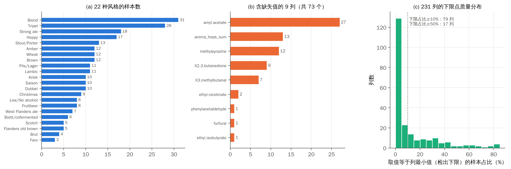
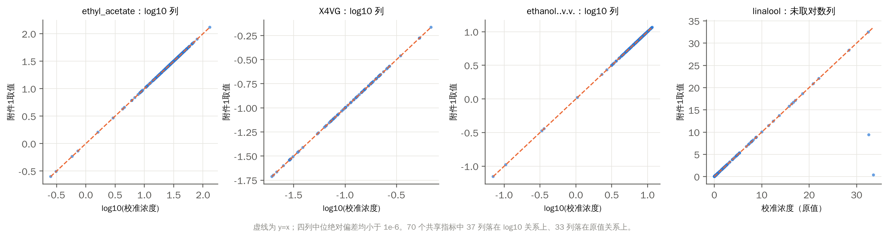
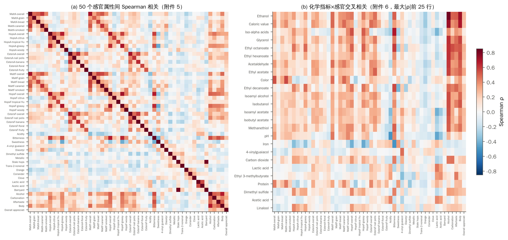
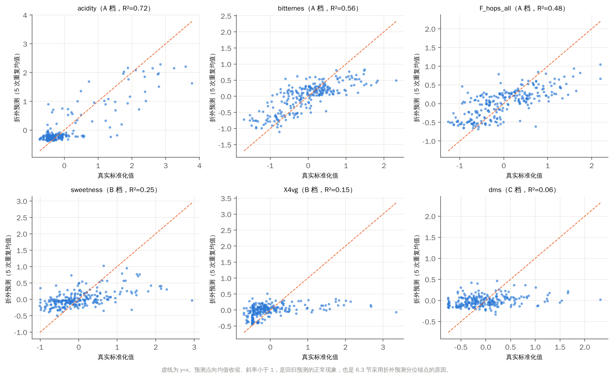
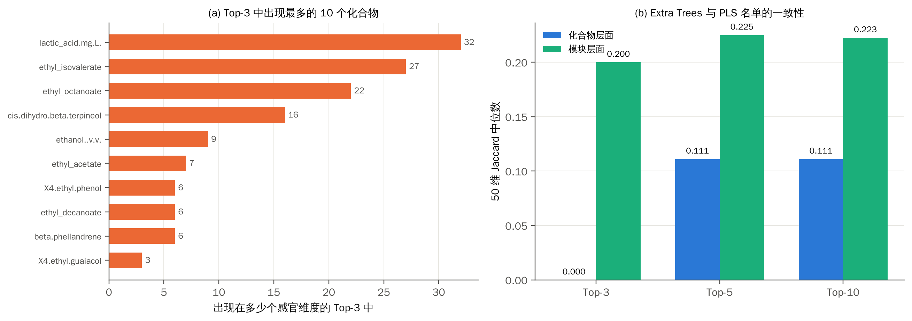
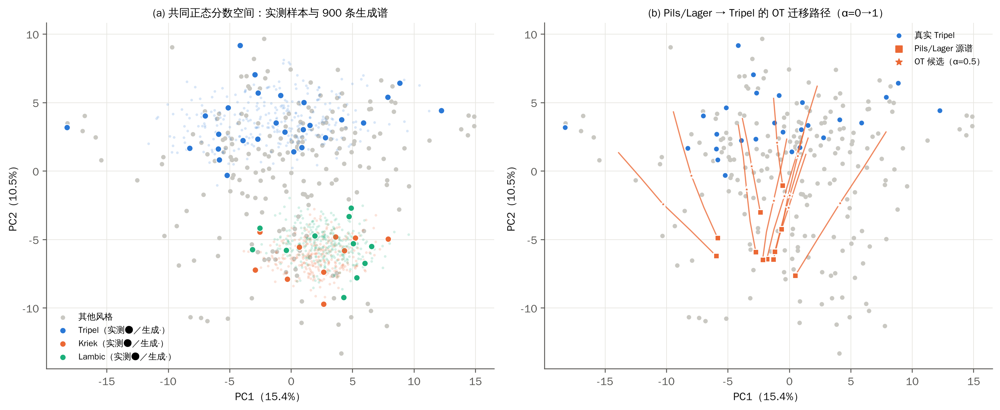
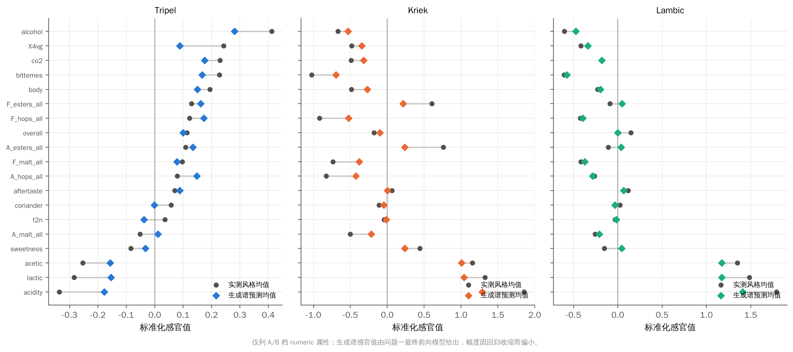
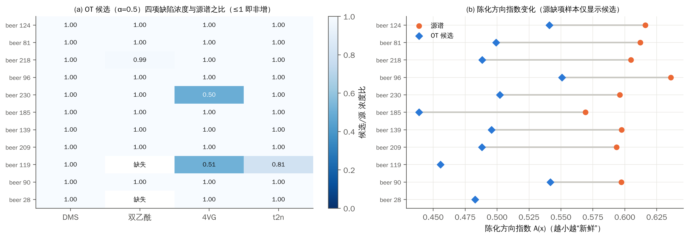

# 一、问题重述

## 1.1 问题背景

啤酒以麦芽、水为主要原料，添加啤酒花后经酵母发酵酿成，素有“液体面包”之称。其风味由数百种化合物共同决定：酒花带来的萜类化合物贡献草本与柑橘香，酵母代谢生成的酯类与高级醇产生水果香与溶剂感，麦芽美拉德产物带来焦糖与烘焙香，野生菌群代谢物形成乳酸、醋酸等酸味，陈化反应则生成纸板味、陈旧酒花味等老化风味。二甲基硫（DMS）、双乙酰、4-乙烯基愈创木酚（4VG）、反-2-壬烯醛（t2n）等化合物一旦超过感官阈值，便会形成煮玉米味、黄油味、丁香/药味、纸板味等缺陷。

传统的感官评价依赖经过训练的品评小组，成本高、周期长、主观差异大。如果能够由化学测量预测感官评分、识别决定各类风味的关键化合物，并在给定风格下设计化学谱，就能把“经验酿造”推进为“数据驱动的风味设计”。题目给出的商用啤酒风味代谢数据集为这一目标提供了基础。

## 1.2 题目数据

附件 1 为 250 款啤酒 × 231 个化学指标的丰度矩阵；附件 2 为化合物间相关矩阵；附件 3 为感官品评表模板（12 张评分卡及汇总表）；附件 4 为 250 款啤酒 50 个感官属性的标准化评分；附件 5、6 分别为感官属性间及化学—感官交叉相关矩阵；附件 7 为论坛评论描述符；附件 8 为感官阈值、属性名称、校准浓度等综合参考数据。数据真实，包含缺失值与异常值。

## 1.3 需要解决的问题

**问题一：数据缺失条件下的感官评分。** 以附件 1 化合物数据为基础，给出附件 3 定义的 Aroma 与 Flavour 两套、约 40 个感官维度的 0–6 分制分级评分。

**问题二：化合物—风味分析。** 利用附件 2 构建化合物共表达图，结合附件 1，给出每个感官维度的 Top-3 关键化合物，并通过 bootstrap 入选频率与不同方法间 Top-3 的 Jaccard 系数论证稳定性，同时论证化学合理性。

**问题三：风格条件生成与风味指纹迁移。** 以 `tasting_category_fine` 为风格标签学习风格条件生成模型，在 Tripel、Kriek、Lambic 等风格下生成合理的化合物谱并给出感官画像；将 Pils/Lager 的化合物谱迁移为 Tripel 风格，且保证 DMS、双乙酰、4VG、t2n、Stale hops 等缺陷不恶化。

# 二、问题分析

## 2.1 总体思路

三个问题构成一条递进链条：问题一建立“化学谱 → 感官”的前向映射，并解决评分尺度问题；问题二在这一映射上回答“哪些化合物起作用”，并用网络结构与重采样检验稳定性；问题三反过来在化学空间中进行生成与迁移，再借助问题一的前向模型得到感官画像。三问共用同一套数据预处理与验证协议，保证数字可以互相引用。

## 2.2 问题一的分析

问题一的难点不在于回归本身，而在于两层信息缺失。其一，附件 1 存在 73 个真实缺失值，需要在训练折内插补；其二，附件 4 给出的是标准化后的连续值（50 列中多数有 200–250 个不同取值），原始 0–6 分制评分没有提供，无法直接作为监督标签。因此本文采用“两段式”建模：先以多输出回归预测 50 维连续感官响应，用交叉验证评价其精度；再建立从连续预测到 0–6 分的映射模型，用于填写评分卡。由于回归预测必然向均值收缩，映射的锚点必须取自预测值自身的分布，而不能直接取自真实标签。此外，附件 8 表明 50 项中 26 项为强度型（numeric）、24 项为勾选型（categorical），二者在模板中的计分方式不同，需要分别建模。

## 2.3 问题二的分析

“关键化合物”需要同时满足三点：模型确实依赖它（重要性高）、换一批样本仍能选中它（稳定）、它不只是风格的代理（不受混杂）。本文以袋外置换重要性度量第一点，以 100 次分层 bootstrap 的入选频率和两种模型间的 Jaccard 系数度量第二点，以风格内置换实验度量第三点。化合物共表达图把高度相关的化合物组织为模块，使结论可以在“单体”与“模块”两个层次上给出，避免把共线化合物之间的偶然排序误读为化学差异。

## 2.4 问题三的分析

化学谱的生成有两个结构性难点：大量化合物处于检出下限（79 列的下限占比超过 10%），普通高斯分布无法产生这种“点质量”；每个风格只有 3–31 个样本，维度却高达 231，样本协方差奇异。本文先用逐列经验分布函数把数据映射到正态分数空间并保留下限点质量，再用 Ledoit–Wolf 收缩估计风格协方差。迁移问题本质上是“把一个分布搬运到另一个分布”，最优传输给出了在平方欧氏代价下最省力的搬运方式，且两个高斯分布之间存在闭式解；缺陷约束则通过投影施加。

全文技术路线如图 1 所示。

{width=95%}

# 三、模型假设

（1）附件 1 中同一列在不同样本间采用一致的测量与校准流程；检出下限处的重复值代表“未检出或低于下限”的状态。

（2）附件 4 的标准化感官值在样本间可比，与原始评分之间保持单调关系，可作为连续回归目标。

（3）250 款啤酒可视为同一总体的独立样本，按风格分层的交叉验证能够反映模型在同类啤酒上的泛化能力。

（4）同一风格内的化学谱经逐列经验分布变换后近似服从多元正态分布，风格间差异主要体现在均值与协方差上。

（5）缺陷“不恶化”以同一储存尺度上的浓度非增作为判据；Stale hops 无对应化学测量，以陈化方向指数作为辅助代理。

# 四、符号说明

| 符号 | 含义 |
|:--:|:--|
| $n,\ p,\ q$ | 样本数（250）、化学指标数（231）、感官属性数（50） |
| $x_i\in\mathbb R^{p}$ | 第 $i$ 款啤酒的化学谱（附件 1 储存尺度） |
| $y_{ij}$ | 第 $i$ 款啤酒第 $j$ 个感官属性的标准化值（附件 4） |
| $c_i$ | 第 $i$ 款啤酒的风格标签 |
| $f(\cdot)$ | 化学谱到感官的多输出回归模型 |
| $\hat z_{ij}$ | 第 $j$ 个属性的折外预测（5 次重复平均） |
| $R^2_j,\ \rho_j,\ \mathrm{MAE}_j$ | 第 $j$ 维的决定系数、Spearman 秩相关、平均绝对误差 |
| $\mathrm{skill}_j$ | 相对风格均值基线的 MSE 技能分数 |
| $q^{\mathrm{OOF}}_{0.05,j},\ q^{\mathrm{OOF}}_{0.95,j}$ | 折外预测的第 5、95 百分位（冻结锚点） |
| $s_{ij},\ b_{ij}$ | numeric 属性的相对评分（0–6）、categorical 属性的勾选结果（0/1） |
| $W=(w_{kl})$ | 化合物共表达图的加权邻接矩阵 |
| $Q$ | 模块度 |
| $I_{jk}$ | 化合物 $k$ 对感官属性 $j$ 的置换重要性 |
| $\pi_{jk}$ | 化合物 $k$ 在 bootstrap 中进入属性 $j$ 的 Top-3 的频率 |
| $J(A,B)$ | 集合 $A,B$ 的 Jaccard 系数 |
| $F_k,\ G$ | 第 $k$ 列的经验分布函数、逐列共同映射 $z=G(x)$ |
| $\mu_c,\ \hat\Sigma_c$ | 风格 $c$ 在共同空间中的均值与收缩协方差 |
| $\delta$ | Ledoit–Wolf 收缩强度 |
| $T(\cdot),\ \alpha$ | 高斯最优传输映射、迁移强度 |
| $W_2$ | 2-Wasserstein 距离 |
| $\mathcal D$ | 四项实测缺陷化合物的下标集合 |
| $A(x)$ | 陈化方向指数 |
| $d(\cdot,\cdot)$ | 共同空间中按 $\sqrt{p}$ 归一化的欧氏距离 |

# 五、数据预处理与探索性分析

## 5.1 数据概况

图 2 给出数据的三个基本特征。（a）22 种风格的样本数极不均衡，最多的 Blond 有 31 款，最少的 Faro 仅 3 款，因此所有交叉验证都必须按风格分层；（b）73 个缺失值集中在 9 列，其中 amyl acetate 缺失 27 个，问题三涉及的 2,3-丁二酮（双乙酰）缺失 9 个；（c）大量列存在重复的最小值，即检出下限，79 列的下限占比超过 10%，17 列超过 50%，4VG 的下限占比达 67.2%。附件 1 实际为 250 款啤酒，与题面所述 226 款不一致，本文以数据为准。

{width=100%}

## 5.2 对数底数与尺度核验

题面指出部分列经过对数变换、需自行核实底数。附件 8「Calibrated chemical dataset」给出了 70 个指标的校准浓度 $c_{ik}$，可与附件 1 的取值 $v_{ik}$ 逐列比对。对第 $k$ 列定义两种偏差：

$$
e^{\log}_k=\operatorname{median}_{i:\,c_{ik}>0}\left|v_{ik}-\log_{10}c_{ik}\right|,\qquad
e^{\mathrm{raw}}_k=\operatorname{median}_{i}\left|v_{ik}-c_{ik}\right| . \qquad (5.1)
$$

若 $e^{\log}_k<10^{-3}$ 则判为 log10 列，若 $e^{\mathrm{raw}}_k<10^{-6}$ 则判为原值列。结果为 37 列 log10、33 列原值，没有不能归类的列。log10 列满足

$$
v_{ik}=\log_{10}c_{ik},\qquad v_{ik}<0\iff c_{ik}<1, \qquad (5.2)
$$

即负值对应原始浓度小于 1 的化合物。需要注意，题面称乙醇、pH、色度、苦度、CO₂ 等理化参数“保留原始量纲”，但核验表明它们同样是 log10 值。图 3 给出四个典型列的核验散点，所有点都严格落在 $y=x$ 上。对未被校准数据覆盖的列，本文建立逐列变换字典，不对其尺度作额外假设；已取对数的列不再重复取对数。

{width=100%}

附件 2 的相关系数同样需要核验。设附件 1 第 $k,l$ 列的秩分别为 $r_{ik},r_{il}$，Spearman 相关系数为

$$
\rho_{kl}=\frac{\sum_{i}(r_{ik}-\bar r_k)(r_{il}-\bar r_l)}{\sqrt{\sum_i(r_{ik}-\bar r_k)^2\sum_i(r_{il}-\bar r_l)^2}} . \qquad (5.3)
$$

将附件 2 的化合物名称映射到附件 1 字段后，用式（5.3）重算的矩阵与附件 2 最大差小于 $10^{-12}$，确认附件 2 为 Spearman 相关矩阵，而非题面所说的 Pearson 相关。

## 5.3 缺失值与检出下限处理

记第 $k$ 列在训练集 $\mathcal T$ 上的最小值为 $m_k=\min_{i\in\mathcal T}v_{ik}$，下限占比为

$$
\phi_k=\frac{1}{|\mathcal T|}\sum_{i\in\mathcal T}\mathbf 1\left(v_{ik}=m_k\right) . \qquad (5.4)
$$

缺失值在每个训练折内用中位数插补，测试折沿用训练折的插补值：

$$
\tilde v_{ik}=\begin{cases}v_{ik}, & v_{ik}\ \text{已观测}\\ \operatorname{median}_{l\in\mathcal T}v_{lk}, & v_{ik}\ \text{缺失}\end{cases} \qquad (5.5)
$$

本文没有对极端值做全局缩尾：缩尾会改动缺陷化合物的源测量值，使问题三的“不恶化”判据失去依据。树模型对单调变换和极端值本身不敏感；PLS 在训练折内先做分位数正态化。问题一曾检验在特征中加入下限指示变量 $\mathbf 1(v_{ik}=m_k)$（$\phi_k\ge0.4$ 的列）：宏平均 MAE 由 0.342834 变为 0.343579，未达到预设的 1% 改善门槛，因此最终模型保持原特征。

## 5.4 相关结构探索

图 4（a）为附件 5 的 50 个感官属性间相关矩阵。同类属性（如麦芽香各子项、酒花香各子项）形成明显的正相关块，酸度、乳酸感、醋酸感三者高度相关，并与甜度、酒体负相关。图 4（b）为附件 6 中化学指标与感官属性交叉相关最强的 25 行：乙醇与酒精感（$\rho=0.82$）、与酒体（0.72）最强，热量值次之；异 α-酸与苦感相关 0.68；甘油、辛酸乙酯、己酸乙酯也与酒精感正相关。这些边际相关为后续建模提供了基准，但它们无法区分直接作用与风格共现，需要在问题二中用模型和置换实验进一步分析。

{width=100%}

## 5.5 验证协议

所有预测评价采用 5 次重复、每次 3 折、按风格分层的交叉验证，共 15 个划分 $\{(\mathcal T_r,\mathcal V_r)\}_{r=1}^{15}$。插补、标准化、分位数变换均只在 $\mathcal T_r$ 上拟合。Faro 仅 3 款，3 折恰好保证每折至少含一款。

比较两种方法 A、B 时，记第 $r$ 个划分上的误差差为 $d_r=\mathrm{MAE}^{A}_r-\mathrm{MAE}^{B}_r$。由于不同划分共享训练样本，$d_r$ 并不独立，直接使用普通 $t$ 区间会低估方差。本文采用 Nadeau–Bengio 修正 [6]：

$$
\hat\sigma^2_{\mathrm{corr}}=\left(\frac{1}{R}+\frac{n_{\mathrm{test}}}{n_{\mathrm{train}}}\right)s_d^2,\qquad
\bar d\pm t_{R-1,0.975}\,\hat\sigma_{\mathrm{corr}}, \qquad (5.6)
$$

其中 $R=15$，$s_d^2$ 为 $d_r$ 的样本方差，$n_{\mathrm{test}}/n_{\mathrm{train}}\approx1/2$。

# 六、问题一：数据缺失条件下的感官评分

## 6.1 建模思路

问题一按“连续预测 → 等级映射 → 模板填写”三步求解。第一步以化学谱预测 50 维标准化感官值，并用交叉验证评价；第二步依据预测能力把 50 维划分为预测支持度三档；第三步把连续预测映射为 0–6 分，强度型属性用折外分位锚点，勾选型属性用父项门控规则，最后按模板公式写入评分卡。

## 6.2 连续感官响应预测模型

**多输出回归。** 设预处理后的化学谱为 $\tilde x_i$，目标为 $y_i=(y_{i1},\dots,y_{iq})^{\top}$，建立多输出回归

$$
\hat y_i=f(\tilde x_i),\qquad f=\arg\min_{f\in\mathcal F}\ \frac{1}{|\mathcal T|}\sum_{i\in\mathcal T}\sum_{j=1}^{q}\left(y_{ij}-f_j(\tilde x_i)\right)^2 . \qquad (6.1)
$$

**Extra Trees。** 主模型为极端随机树 [2]。每棵树在节点 $t$ 上随机抽取 $\lceil 0.7p\rceil$ 个特征，对每个特征在其取值范围内随机产生一个切分点 $s$，在这些候选中选择使多输出方差下降最大的切分：

$$
\Delta(t;k,s)=\sum_{j=1}^{q}\left[N_t\,\mathrm{Var}_t(y_j)-N_{t_L}\mathrm{Var}_{t_L}(y_j)-N_{t_R}\mathrm{Var}_{t_R}(y_j)\right], \qquad (6.2)
$$

其中 $t_L=\{i\in t:\tilde x_{ik}\le s\}$、$t_R=t\setminus t_L$，$N$ 为节点样本数。叶节点最少 3 个样本，共 $B=160$ 棵树，预测取平均：

$$
f(\tilde x)=\frac{1}{B}\sum_{b=1}^{B}h_b(\tilde x) . \qquad (6.3)
$$

随机切分点降低了单棵树的方差，多棵树平均进一步降低方差，适合样本少、特征多、存在大量并列值的本数据。

**PLS 回归。** 作为线性对照，采用 8 成分偏最小二乘 [10]。设 $X$、$Y$ 为中心化后的特征与目标矩阵，PLS 寻找潜变量 $T=XW$，使

$$
X=TP^{\top}+E,\qquad Y=TC^{\top}+F,\qquad
w_h=\arg\max_{\|w\|=1}\operatorname{cov}^2\left(Xw,\ Y\right), \qquad (6.4)
$$

逐个提取 8 个成分后得到 $\hat Y=XW(P^{\top}W)^{-1}C^{\top}$。PLS 之前在训练折内做分位数正态化。

**基线。** 训练折全体均值 $\hat y_{ij}=\bar y_j^{\mathcal T}$；训练折风格均值 $\hat y_{ij}=\bar y_{j}^{\mathcal T,c_i}$，即同风格训练样本的均值。后者利用了真实风格标签，是一个较强的基线：化学模型只有超过它，才说明化学谱提供了风格以外的信息。

## 6.3 评价指标

对第 $j$ 维，以折外预测 $\hat y_{ij}$ 计算

$$
\mathrm{MAE}_j=\frac1n\sum_{i}\left|y_{ij}-\hat y_{ij}\right|,\qquad
R^2_j=1-\frac{\sum_i(y_{ij}-\hat y_{ij})^2}{\sum_i(y_{ij}-\bar y_j)^2}, \qquad (6.5)
$$

Spearman 秩相关 $\rho_j$ 按式（5.3）计算。为衡量化学模型相对风格均值的增量，定义 MSE 技能分数

$$
\mathrm{skill}_j=1-\frac{\mathrm{MSE}^{\,\mathrm{ET}}_j}{\mathrm{MSE}^{\,\mathrm{style}}_j} . \qquad (6.6)
$$

$\mathrm{skill}_j>0$ 表示化学模型的平方误差小于风格均值基线。宏平均指标对 50 维等权平均，再对 5 次重复平均。

## 6.4 模型求解与结果

表 1 问题一连续感官预测的折外结果（5 次重复×3 折）

| 方法 | 宏平均 MAE↓ | 宏平均 R²↑ | 宏平均 Spearman↑ |
|:--|--:|--:|--:|
| 训练折全体均值 | 0.4172 | −0.0080 | — |
| 训练折风格均值 | 0.3584 | 0.1498 | 0.3550 |
| PLS（8 成分） | 0.3701 | 0.1647 | — |
| Extra Trees | **0.3428** | **0.2330** | **0.4124** |

注：PLS 为单次三折结果，其余为 5 次重复×3 折结果。

由表 1，Extra Trees 在三项指标上均最优：相较全体均值，宏平均 MAE 下降 17.84%；相较风格均值下降 4.34%，宏平均 R² 提高 0.083。按式（5.6）对 15 个划分的配对差值作修正推断，Extra Trees 相对风格均值的平均相对改善为 4.32%，近似 95% 区间为 [1.75%, 6.90%]，区间不含 0，说明化学谱在风格之外提供了稳定的增量信息。分类型看，numeric 26 维 R² 为 0.301，categorical 24 维为 0.159；50 维中有 43 维的 MAE、48 维的 R² 优于风格均值。

图 5 给出逐维指标分布。预测能力在维度间差异明显：酸度（$R^2=0.721$）、酒精感（0.676）、醋酸感（0.662）、乳酸感（0.659）、苦感（0.560）预测最好，这些属性都有明确的化学来源（有机酸、乙醇、异 α-酸）；花香风味、陈旧酒花、马厩味的 $R^2$ 接近 0，它们由痕量化合物或复杂混合效应决定。酒精感虽然 $R^2$ 很高，但 $\mathrm{skill}=-0.057$，说明它的可预测性主要来自风格间差异（如高度 Tripel 与低醇啤酒），化学模型并未超过风格均值。

{width=85%}

图 6 选取不同档位的 6 个属性，比较折外预测与真实值。预测与真实值整体沿 $y=x$ 方向分布，但斜率明显小于 1，即预测值向均值收缩。这是回归模型在信噪比有限时的必然结果：最小化平方误差的预测是条件期望 $E[y\mid x]$，其方差为 $\mathrm{Var}(y)-E[\mathrm{Var}(y\mid x)]$，总是小于真实值的方差。这一现象直接决定了 6.6 节等级映射锚点的选取方式。

{width=95%}

**缺失鲁棒性。** 在自然缺失之外，再以概率 0.1 随机遮蔽已观测的特征值，即对每个 $(i,k)$ 独立抽取 $M_{ik}\sim\mathrm{Bernoulli}(0.1)$，令 $M_{ik}=1$ 的值缺失，再按式（5.5）插补后预测。Extra Trees 全 50 维平均 $R^2$ 由 0.224 降至 0.207，下降 0.017；PLS 由 0.165 变为 0.165，基本不变。说明在 10% 随机缺失下，模型性能只发生小幅变化。

## 6.5 预测支持度分档

为了让后续交付与解释都有据可依，按 5 次重复折外平均 $R^2_j$ 把 50 维划分为三档：

$$
\mathrm{tier}_j=\begin{cases}\mathrm{A}, & R^2_j\ge0.3\\ \mathrm{B}, & 0.1\le R^2_j<0.3\\ \mathrm{C}, & R^2_j<0.1\end{cases} \qquad (6.7)
$$

同时单列 $\mathrm{skill}_j\le0$ 的属性。分档结果为 A 档 15 项、B 档 21 项、C 档 14 项（numeric 11/8/7，categorical 4/13/7），见图 7（a）；酒精感、酒体位于 A 档但 $\mathrm{skill}\le0$，标注“未优于风格均值”。五个缺陷感官维度中，dms、diacetyl、stale_hops 位于 C 档，X4vg、t2n 位于 B 档。A、B 档的预测可直接用于评分与解释，C 档的评分只作参考分。

## 6.6 等级映射模型

**numeric 属性：折外分位锚点映射。** 由 6.4 节，预测值向均值收缩，若以真实标签的分位点作锚点，几乎没有样本能得到高分（诊断实验中 5、6 分合计仅约 2%）。因此以预测值自身的分布为参考：取每款啤酒 5 次重复折外预测的均值

$$
\hat z_{ij}=\frac15\sum_{r=1}^{5}\hat y^{(r)}_{ij}, \qquad (6.8)
$$

对每个 numeric 属性计算 250 个 $\hat z_{ij}$ 的第 5、95 百分位 $q^{\mathrm{OOF}}_{0.05,j}$、$q^{\mathrm{OOF}}_{0.95,j}$ 并冻结，线性映射到 0–6 并取整：

$$
s_{ij}=\operatorname{round}\left[\operatorname{clip}\left(6\cdot\frac{\hat z_{ij}-q^{\mathrm{OOF}}_{0.05,j}}{q^{\mathrm{OOF}}_{0.95,j}-q^{\mathrm{OOF}}_{0.05,j}},\ 0,\ 6\right)\right] . \qquad (6.9)
$$

该映射对每个属性单调保序，因此不改变样本间的排序，也不影响 6.4 节的任何精度指标；它把预测分布的中间 90% 均匀铺展到 0–6 分。所有 26 个属性均有 $q^{\mathrm{OOF}}_{0.05,j}<q^{\mathrm{OOF}}_{0.95,j}$。12 张评分卡、250 款主表以及问题三生成谱均使用同一组锚点。

**categorical 属性：父项门控勾选。** 模板中每个子项（如“麦芽香—谷物”）只能勾选或不勾选，其展示分等于父项强度乘以勾选结果。附件 4 的勾选型属性是多人勾选汇总后的标准化值，可理解为“勾选倾向”。本文以训练折均值为参考，定义勾选规则

$$
b_{ij}=\mathbf 1\left(s_{i,\mathrm{pa}(j)}>0\right)\cdot\mathbf 1\left(\hat z_{ij}>\bar y^{\,\mathcal T}_{ij}\right), \qquad (6.10)
$$

其中 $\mathrm{pa}(j)$ 为父项（如 A_malt_grain 的父项为 A_malt_all），$\bar y^{\,\mathcal T}_{ij}$ 为第 $i$ 款啤酒作为测试样本时 5 个对应训练折真实值的平均，保证规则严格折外。第一个因子保证“父项强度为 0 时子项不勾选”，与模板逻辑一致。模板展示值为

$$
\mathrm{disp}_{ij}=s_{i,\mathrm{pa}(j)}\cdot b_{ij} . \qquad (6.11)
$$

## 6.7 评分结果

图 7（b）为 26 项 numeric 相对评分在 250 款中的分布：0 分 18.5%，1–5 分各占 12%–16%，6 分 9.6%，分布均匀，评分卡有良好的区分度。categorical 属性经父项门控后，各属性最终勾选率为 29.2%–58.4%，中位数 44.2%。

{width=95%}

附件 3 实际包含 beer_1–beer_12 共 12 张评分卡及 summary 汇总表。本文按每张评分卡的 Beer# 单元格与样本编号匹配，在 0–6 对应格标记强度、在勾选格标记子项，由模板原有公式计算分数。核对时发现模板 summary 表 barnyard 列（AX 列）误引用了 Stale hops 单元格 `$AG$76`，本文在填写副本中改为 `$AG$90`，重算后 summary 表与程序计算值逐格一致。评分卡中的 Acetaldehyde 一行在附件 4 中没有对应属性，予以留空。

图 8 为 12 款啤酒 26 项 numeric 的评分。结果与各风格的公认特征高度一致：

- Lambic（beer 12）的乳酸感 4 分、酸度 3 分、醋酸感 3 分，在 12 款中最高，苦感 0 分、酒花香 0 分，符合自然发酵酸啤“高酸、低苦、无酒花香”的特征；
- 两款低/无醇啤酒（beer 2、10）的酒精感、酒体、苦感均为 0，橙皮评分 5–6 分，符合其加入果味与香料调味的常见做法；
- Strong ale（beer 4）的酯香 6 分、麦芽风味 6 分、酒精感 6 分、总体评价 6 分，体现了烈性艾尔“浓郁、醇厚、高酒精”的特点；
- 两款 Hoppy（beer 8、9）的酒花香 4–5 分、苦感 5 分，均处于高位。

带“*”的为 C 档属性，仅作参考分。

{width=100%}

## 6.8 小结

问题一建立了“Extra Trees 连续预测 + 折外分位锚点映射 + 父项门控勾选”的评分模型。连续预测在 15 个划分上稳定优于风格均值基线（相对改善 4.32%，区间 [1.75%, 6.90%]），酸度、苦感、乳酸感等有明确化学来源的属性预测最好；等级映射保序且锚点冻结，使评分卡既有区分度又不改变模型精度；预测支持度三档为问题二、三的解释提供了统一依据。

# 七、问题二：化合物—风味分析

## 7.1 建模思路

问题二分四步：（1）由附件 2 构建化合物共表达图并划分模块；（2）以 bootstrap 袋外置换重要性给出每个感官维度的 Top-3 候选及其入选频率；（3）结合问题一的预测支持度与模块信息，对 50 维的结论进行两维分档；（4）以风格内置换检验 Top-3 是否只是风格代理，并结合化学知识论证合理性。

## 7.2 化合物共表达图模型

以化合物为节点，以附件 2 的 Spearman 相关构建加权无向图：

$$
w_{kl}=\begin{cases}|\rho_{kl}|, & |\rho_{kl}|\ge\tau,\ k\ne l\\ 0, & \text{其他}\end{cases},\qquad \tau=0.6 . \qquad (7.1)
$$

阈值 0.6 对应“强相关”，既保留主要的共表达关系，又避免图过于稠密。在该图上以 Louvain 算法 [5] 最大化模块度

$$
Q=\frac{1}{2m}\sum_{k,l}\left(w_{kl}-\frac{d_kd_l}{2m}\right)\mathbf 1\left(g_k=g_l\right), \qquad (7.2)
$$

其中 $d_k=\sum_l w_{kl}$ 为节点加权度，$m=\frac12\sum_{k,l}w_{kl}$，$g_k$ 为节点 $k$ 所属模块。Louvain 交替执行“节点局部移动以增大 $Q$”与“模块合并为超节点”两步，直至 $Q$ 不再增加；随机种子固定以保证可复现。

得到的网络有 266 条边、130 个非孤立节点，划分出 19 个非单点模块，最大模块含 23 个指标，另有 101 个孤立节点（图 9）。模块与化学来源基本对应：酵母酯类与高级醇、酒花萜类与倍半萜、麦芽美拉德产物、野生菌群代谢物各自聚集。去除 14 个理化、派生或混合指标（如 pH、色度、kcalperc、esters_sum）后，217 个单体化学指标作为 Top-3 的候选集合 $\mathcal K$。

{width=90%}

## 7.3 关键化合物识别模型

**置换重要性。** 对已训练的模型 $f$ 与评价集 $\mathcal V$，把第 $k$ 列在 $\mathcal V$ 内随机打乱得到 $\tilde X^{(k)}$，第 $j$ 个属性的重要性定义为误差的增加量 [3]：

$$
I_{jk}=\frac{1}{L}\sum_{\ell=1}^{L}\mathrm{MAE}_j\left(f;\tilde X^{(k,\ell)}_{\mathcal V}\right)-\mathrm{MAE}_j\left(f;X_{\mathcal V}\right),\qquad L=3 . \qquad (7.3)
$$

打乱切断了化合物 $k$ 与感官之间的联系而保持其边际分布不变，因此 $I_{jk}$ 直接度量模型对化合物 $k$ 的依赖。与基于不纯度的重要性相比，它不偏向取值多的特征，也可同样用于 PLS。

**分层 bootstrap。** 第 $b$ 次（$b=1,\dots,100$）在每种风格内有放回抽取与原风格等量的样本作为训练集 $\mathcal T_b$，未被抽中的样本为袋外集 $\mathcal O_b$（平均约 88 款）。在 $\mathcal T_b$ 上训练 Extra Trees 与 PLS，在 $\mathcal O_b$ 上按式（7.3）计算 $I^{(b)}_{jk}$。最终名单按平均重要性取前三：

$$
\mathrm{Top3}_j=\operatorname{arg\,top3}_{k\in\mathcal K}\ \bar I_{jk},\qquad \bar I_{jk}=\frac{1}{100}\sum_{b=1}^{100}I^{(b)}_{jk} . \qquad (7.4)
$$

**入选频率与 Wilson 区间。** 记 $\mathrm{Top3}^{(b)}_j$ 为第 $b$ 次的前三名，化合物 $k$ 的入选频率为

$$
\pi_{jk}=\frac{1}{100}\sum_{b=1}^{100}\mathbf 1\left(k\in\mathrm{Top3}^{(b)}_j\right) . \qquad (7.5)
$$

为描述 100 次重采样的 Monte Carlo 精度，给出 Wilson 区间

$$
\frac{\pi+\frac{z^2}{2N}\pm z\sqrt{\frac{\pi(1-\pi)}{N}+\frac{z^2}{4N^2}}}{1+\frac{z^2}{N}},\qquad N=100,\ z=1.96 . \qquad (7.6)
$$

**模块命中率。** 第 $b$ 次的前三名中至少有一个属于模块 $g$，则记一次命中：

$$
\eta_{jg}=\frac{1}{100}\sum_{b=1}^{100}\mathbf 1\left(\exists\,k\in\mathrm{Top3}^{(b)}_j:\ g_k=g\right) . \qquad (7.7)
$$

**方法间一致性。** Extra Trees 与 PLS 的 Top-$k$ 名单 $A$、$B$ 之间的 Jaccard 系数为

$$
J(A,B)=\frac{|A\cap B|}{|A\cup B|} . \qquad (7.8)
$$

把名单中的化合物替换为所属模块后再计算，即得到模块层面的 Jaccard 系数。

## 7.4 求解结果

图 10 给出 50 个感官维度的 Top-3 及其入选率和模块命中率。入选率最高的组合包括：酸度、乳酸感、醋酸感 ← 乳酸（均为 100%）、酒精感 ← 乙醇（93%）、酒体 ← 乙醇（94%）、F_malt_all ← 乳酸（99%）、苦感 ← 辛酸乙酯（91%）。

{width=88%}

图 11（b）比较两种模型的名单。Top-3 层面化合物 Jaccard 中位数为 0.000，模块层面为 0.200；Top-10 时分别为 0.111 与 0.223。树模型与线性模型在单体层面很少一致，但在模块层面的一致性明显更高。原因在于同一模块内的化合物高度相关，两种模型可能各自选中其中不同的成员。因此，在模块层面报告结论比在单体层面更稳健。

{width=95%}

**两维分档。** 结合问题一的预测支持度（式 6.7）与本节的稳定性信息，定义解释稳定性：

$$
\mathrm{stab}_j=\begin{cases}\text{单体稳定}, & \min_{k\in\mathrm{Top3}_j}\pi_{jk}\ge0.5\ \text{且}\ \min_{k\in\mathrm{Top3}_j}\bar I_{jk}>0\\ \text{模块线索}, & \text{否则，若}\ \max_{g:\,|g|\ge2}\eta_{jg}\ge0.7\\ \text{探索性}, & \text{其他}\end{cases} \qquad (7.9)
$$

对每个 Top-3 候选，另列出同模块内 $|\rho|\ge0.8$ 的“高度相关备选”（至多 3 个），如 4-乙基苯酚 ↔ 4-乙基愈创木酚（+0.81）；理化与派生指标（如乙醇 ↔ kcalperc，+0.85）单列为“派生相关指标”。

表 2 预测支持度与解释稳定性的交叉分布（维度数）

| 预测支持度 | 单体稳定 | 模块线索 | 探索性 | 合计 |
|:--:|--:|--:|--:|--:|
| A | 3 | 8 | 4 | 15 |
| B | 0 | 11 | 10 | 21 |
| C | 0 | 4 | 10 | 14 |

由表 2，单体稳定的 3 个维度全部来自 A 档，说明“可预测”与“可解释”高度一致：F_hops_all（异戊酸乙酯、乳酸、cis-二氢-β-萜品醇）、aftertaste（异戊酸乙酯、辛酸乙酯、乙醇）、alcohol（乙醇、辛酸乙酯、乳酸）。其中 alcohol 未优于风格均值，其 Top-3 主要反映风格差异。另有 23 个维度可以在模块层面给出稳定结论。C 档 14 个维度的 Top-3 只作为探索线索。各维完整名单见附录表 A1。

## 7.5 风格混杂的敏感性分析

图 11（a）显示 Top-3 高度集中：乳酸出现在 32 个维度的 Top-3 中，异戊酸乙酯 27 个，辛酸乙酯 22 个，cis-二氢-β-萜品醇 16 个。乳酸是 Lambic、Kriek 等自然发酵酸啤的标志物，这提示部分重要性可能来自“酸啤与非酸啤”的风格差异，而不是乳酸对这些感官属性的直接作用。

**风格内置换。** 为区分两者，把式（7.3）中的全局置换改为只在同一风格内部打乱：

$$
I^{\mathrm{within}}_{jk}=\frac1L\sum_{\ell=1}^{L}\mathrm{MAE}_j\left(f;\tilde X^{(k,\ell)}_{\mathcal V\mid c}\right)-\mathrm{MAE}_j\left(f;X_{\mathcal V}\right), \qquad (7.10)
$$

其中 $\tilde X_{\mathcal V\mid c}$ 表示第 $k$ 列只在 $\{i\in\mathcal V:c_i=c\}$ 内随机排列。风格内置换保留了化合物 $k$ 与风格之间的关联，只破坏风格内部的变异 [9]。若化合物的作用完全来自风格间差异，则 $I^{\mathrm{within}}_{jk}\approx0$；若在同风格内仍有预测作用，则 $I^{\mathrm{within}}_{jk}>0$。定义保留比例

$$
\kappa_{jk}=\frac{I^{\mathrm{within}}_{jk}}{I^{\mathrm{glob}}_{jk}} . \qquad (7.11)
$$

由于风格内变异本就小于全局变异，$\kappa$ 天然小于 1，因此同时考察风格内排名。

实验沿用问题一的 15 个划分与相同的 Extra Trees 配置重新拟合，重拟合预测与原折外预测逐值一致（最大差 $7\times10^{-16}$）。在同一测试折、同一模型上配对比较两种置换，评价集为测试折中同风格至少 2 款的样本（1215/1250）。

表 3 原 Top-3 候选在风格内置换下的变化（150 条）

| 指标 | 结果 |
|:--|--:|
| 全局置换重要性 > 0 | 99.3% |
| 风格内置换重要性 > 0 | 83.3% |
| 保留比例 $\kappa$ 中位数 | 0.187 |
| 风格内仍在 217 个候选的 Top-10 | 72% |
| 风格内仍在 Top-3 | 54% |

表 4 高频化合物的风格内置换结果

| 化合物 | 出现维度数 | $\kappa$ 中位数 | 风格内 >0 比例 | 风格内仍在 Top-10 |
|:--|--:|--:|--:|--:|
| 乳酸 | 32 | 0.020 | 59.4% | 43.8% |
| 异戊酸乙酯 | 27 | 0.244 | 92.6% | 85.2% |
| 辛酸乙酯 | 22 | 0.236 | 86.4% | 81.8% |
| cis-二氢-β-萜品醇 | 16 | 0.258 | 93.8% | 87.5% |
| 乙醇 | 9 | 0.131 | 66.7% | 55.6% |
| 乙酸乙酯 | 7 | 0.206 | 100% | 85.7% |

{width=88%}

结合表 3、表 4 与图 12，得到三点结论：

（1）**乳酸在多个非酸味属性上的重要性对风格间差异敏感，而在酸相关属性上仍保留稳定的风格内预测关联。** 对苦感、酒精感、4VG 感官，乳酸的风格内排名分别降至第 212、155、40 位；对酸度、乳酸感、醋酸感，乳酸在风格内仍排第 1，15 个划分中有 13–14 个为正。这与乳酸菌产酸的机理一致。

（2）**4VG 是最清晰的化合物—感官对应。** 4VG 对 X4vg 感官维度的风格内保留比例为 96%，风格内排名由全局第 2 升至第 1。4VG 由酵母的酚酸脱羧酶作用于阿魏酸生成，是小麦啤、Saison 丁香味的直接来源，其作用不依赖风格。

（3）**酯类与酒花萜类候选在风格内仍然有效。** 异戊酸乙酯、辛酸乙酯、cis-二氢-β-萜品醇的保留比例约 0.24–0.26，风格内仍在 Top-10 的比例为 82%–88%，说明它们对酒花香、苦感、余味等属性的作用并不只是风格代理。

## 7.6 化学合理性论证

表 5 主要关键化合物的来源与作用机理

| 化合物 | 来源（附件 8） | 主要关联感官 | 机理 |
|:--|:--|:--|:--|
| 乳酸 | 野生菌群 | 酸度、乳酸感、醋酸感 | 乳酸菌发酵产酸，降低 pH，形成柔和酸味 |
| 4-乙烯基愈创木酚 | 酵母 | 4VG（丁香、烟熏） | 酚酸脱羧酶将阿魏酸转化为 4VG |
| 乙醇 | 酵母 | 酒精感、酒体、余味 | 糖酵解终产物，提供温热感与饱满度 |
| 异戊酸乙酯 | 其他（陈化、酒花降解） | 酒花香、余味、马厩味 | 异戊酸（亮氨酸代谢或酒花 α-酸降解产物）与乙醇酯化，带水果香，随陈化增加 |
| 辛酸乙酯、癸酸乙酯 | 酵母 | 苦感、余味、酯香 | 中链脂肪酸乙酯，赋予苹果、蜡质香，与高发酵度共现 |
| 乙酸乙酯 | 酵母 | 酯香、溶剂感 | 醇酰基转移酶生成，高浓度时呈指甲油味 |
| cis-二氢-β-萜品醇、β-水芹烯 | 酒花 | 酒花香与风味 | 酒花精油萜类及其转化产物 |
| 4-乙基苯酚/4-乙基愈创木酚 | 野生菌群 | 酸度、麦芽风味 | 酒香酵母（Brettanomyces）还原乙烯基酚生成，带马厩、烟熏味 |
| 甲硫醇（MeSH） | 酵母 | DMS 维度（C 档） | 含硫化合物，与 DMS 同属煮蔬菜类异味 |

表 5 中的对应关系与酿造化学的公认知识一致，说明模型识别出的不是统计偶然。对 DMS、双乙酰、陈旧酒花等 C 档维度，Top-3 只能作为线索：它们由痕量化合物决定，且感官评分本身噪声较大。

## 7.7 小结

问题二构建了 19 个非单点模块的化合物共表达网络，以 100 次分层 bootstrap 袋外置换重要性给出 50 维的 Top-3，并用入选率、模块命中率、Jaccard 系数和风格内置换四个层次检验稳定性。结果表明：3 个维度的单体候选稳定，23 个维度可给出模块层面的稳定结论；乳酸的普遍入选很大程度上源于风格差异，但它在酸味属性上的作用在风格内依然成立；4VG 与 4VG 感官的对应最清晰。

# 八、问题三：风格条件生成与跨风格迁移

## 8.1 建模思路

问题三的核心是在化学空间中建立风格条件分布 $p(x\mid c)$。本文先构造逐列经验分布映射 $G$，把化学谱变换到正态分数空间并保留检出下限的点质量；在该空间中对每个风格拟合 Ledoit–Wolf 收缩高斯，采样后经 $G^{-1}$ 回到原尺度即得到生成谱。迁移时，在同一空间中求源风格与目标风格两个高斯之间的最优传输映射，沿传输路径移动源谱，再对缺陷化合物施加非增投影，并按运行前冻结的四条标准验收。

## 8.2 经验边际映射模型

对插补后的训练数据逐列构造经验分布。设第 $k$ 列不同取值为 $v_1<v_2<\dots<v_M$，对应样本数 $n_1,\dots,n_M$，记累计比例

$$
b_l=\frac1n\sum_{r\le l}n_r,\qquad a_l=b_l-\frac{n_l}{n},\qquad l=1,\dots,M . \qquad (8.1)
$$

**正向映射。** 并列值取中间秩，再经标准正态分位函数变换：

$$
F_k(v_l)=\frac{a_l+b_l}{2},\qquad z_k=G_k(v)=\Phi^{-1}\left(F_k(v)\right), \qquad (8.2)
$$

两个取值之间线性插值，超出训练范围时截断到端点，从而不会出现无穷大的正态分数。

**逆映射。** 对并列块（$n_l\ge2$）把整个概率区间映射为同一个值，对单点在相邻点之间线性插值：

$$
G^{-1}_k(z)=\begin{cases}v_l, & \Phi(z)\in(a_l,\,b_l),\ n_l\ge2\\ \text{相邻单点间线性插值}, & \text{其他}\end{cases} \qquad (8.3)
$$

**点质量保持性质。** 若潜在变量 $z_k\sim N(\mu,\sigma^2)$，则生成值等于下限 $v_1$ 的概率为

$$
P\left(G^{-1}_k(z_k)=v_1\right)=P\left(\Phi(z_k)<b_1\right)=\Phi\left(\frac{\Phi^{-1}(b_1)-\mu}{\sigma}\right) . \qquad (8.4)
$$

当某风格在潜在空间中的均值与方差贴合其真实分布时，生成样本的下限占比也就贴合真实下限占比。普通高斯生成器在原尺度上是连续分布，生成值恰好等于下限的概率为 0，只能靠截断产生下限值，这正是首版基线下限占比严重偏低的原因。$G$ 由全体风格共同的训练数据构建，生成与迁移在同一坐标中进行，风格之间的距离可以直接比较。

## 8.3 风格条件收缩高斯模型

在共同空间中，风格 $c$ 的样本 $\{z_i:c_i=c\}$ 只有 $n_c$ 个（Tripel 28、Kriek 10、Lambic 11、Pils/Lager 11），而 $p=231$，样本协方差 $S_c$ 奇异。采用 Ledoit–Wolf 收缩估计 [4]：

$$
\hat\Sigma_c=(1-\delta_c)\,S_c+\delta_c\,\nu_cI_p,\qquad \nu_c=\frac{\operatorname{tr}S_c}{p}, \qquad (8.5)
$$

收缩强度由最小化期望 Frobenius 损失 $E\|\hat\Sigma_c-\Sigma_c\|_F^2$ 给出：

$$
\delta_c=\min\left(1,\ \frac{\bar\beta^2_c}{\|S_c-\nu_cI_p\|_F^2}\right),\qquad
\bar\beta^2_c=\frac{1}{n_c^2}\sum_{i:\,c_i=c}\left\|(z_i-\bar z_c)(z_i-\bar z_c)^{\top}-S_c\right\|_F^2 . \qquad (8.6)
$$

$\hat\Sigma_c$ 恒为正定。生成时采样 $z\sim N(\mu_c,\hat\Sigma_c)$，即 $z=\mu_c+\hat\Sigma_c^{1/2}\varepsilon$、$\varepsilon\sim N(0,I_p)$，再令 $x=G^{-1}(z)$。由式（8.3），生成值自动落在训练观测范围内，无需额外截断。

全数据拟合时的收缩强度为 Tripel 0.42、Kriek 0.66、Lambic 0.68，样本越少收缩越强；收缩后相关矩阵非对角元素的平方和占总平方和的 72%–87%，模型保留了相当的相关结构。

## 8.4 生成质量评价指标

沿用首版基线的三折风格分层划分与相同随机数，在首版的评价坐标（训练折中位数插补加标准化）中比较三种生成器：本文潜在高斯、首版储存尺度风格高斯（原尺度拟合高斯并截断到观测范围）、无条件高斯。对每个“折×风格”单元生成 $N_g=300$ 条，与留出真实样本 $\{u_i\}_{i=1}^{N_r}$ 比较以下指标（$\tilde z$ 为生成样本）：

$$
\mathrm{ME}=\frac1p\sum_{k=1}^{p}\left|\bar{\tilde z}_k-\bar u_k\right|,\qquad
\mathrm{W}_1=\frac1p\sum_{k=1}^{p}\int_{0}^{1}\left|\tilde F_k^{-1}(t)-F_{u,k}^{-1}(t)\right|dt, \qquad (8.7)
$$

$$
\mathrm{FE}=\frac{1}{|\mathcal L|}\sum_{k\in\mathcal L}\left|\hat\phi^{\mathrm{gen}}_k-\hat\phi^{\mathrm{real}}_k\right|,\qquad
\mathrm{CR}=\sqrt{\frac{2}{p(p-1)}\sum_{k<l}\left(\tilde r_{kl}-r_{kl}\right)^2}, \qquad (8.8)
$$

其中 $\mathrm W_1$ 为逐坐标一维 Wasserstein 距离的平均，$\mathcal L$ 为训练下限占比不低于 10% 的列，$\hat\phi$ 为下限占比，$\mathrm{CR}$ 为去除风格中心后合并计算的相关矩阵均方根误差。另以最近邻距离比

$$
\mathrm{NNR}=\frac{\frac{1}{N_g}\sum_{i}\min_{l\in\mathcal T_c}\|\tilde z_i-z_l\|}{\frac{1}{N_r}\sum_{i}\min_{l\in\mathcal T_c}\|u_i-z_l\|} \qquad (8.9)
$$

衡量生成样本相对训练样本的贴近程度：显著小于 1 意味着过度贴近训练集，显著大于 1 意味着偏离数据流形。

## 8.5 生成结果

表 6 生成器留出保真比较（9 个“折×风格”单元等权平均，越小越好）

| 指标 | 潜在高斯（本文） | 首版风格高斯 | 无条件高斯 |
|:--|--:|--:|--:|
| 逐坐标均值误差 ME | **0.884** | 0.917 | 1.059 |
| 一维 Wasserstein $\mathrm W_1$ | **0.965** | 1.078 | 1.235 |
| 下限占比误差 FE | **0.168** | 0.277 | 0.305 |
| 相关矩阵 RMSE CR | 0.316 | 0.323 | **0.303** |
| 最近邻距离比 NNR | 0.870 | 0.829 | 1.078 |

由表 6 与图 13，潜在高斯在均值、边际分布与下限点质量三项上均优于首版：$\mathrm W_1$ 下降 10.5%，下限占比误差下降 39.4%。全数据拟合时，4VG 的下限占比在 Tripel 中实测 82.1%、生成 80.7%（首版仅 33.7%），Kriek 实测 100%、生成 91.3%（首版 54.7%），Lambic 实测 90.9%、生成 92.3%（首版 45.7%），与式（8.4）的理论预期一致。相关结构方面，三种模型差异较小，无条件高斯略优，说明在小样本下联合结构的估计仍有改进空间。生成样本中精确复制训练样本的数量为 0，NNR 为 0.870，没有出现对训练样本的复制。

{width=95%}

图 14（a）把实测样本与 900 条生成谱投影到共同空间的前两个主成分上（解释方差 15.4%、10.5%）。Tripel 生成谱覆盖了真实 Tripel 所在区域；Kriek 与 Lambic 生成谱集中在第二主成分负方向，与两种酸啤的真实位置重合，并与 Tripel 明显分开。

{width=100%}

**感官画像。** 以问题一在全体样本上拟合的前向模型预测生成谱的感官值，并按式（6.9）的冻结锚点换算评分。图 15 比较 A、B 档 numeric 属性的生成谱预测均值与实测风格均值：三种风格的方向全部一致。Kriek、Lambic 的酸度为 +1.29、+1.41（实测 +1.86、+1.79），乳酸感 +1.04、+1.17，苦感 −0.70、−0.57，呈现“高酸、低苦”的酸啤画像；Tripel 的酒精感 +0.28（实测 +0.41）、苦感 +0.17、酒花风味 +0.17，呈现“高酒精、中等苦度、果香酯香突出”的画像。预测幅度普遍小于实测，来自前向模型的回归收缩。

{width=100%}

## 8.6 跨风格迁移模型

**高斯最优传输。** 在共同空间中，源风格（Pils/Lager）与目标风格（Tripel）分别为 $N(\mu_s,\Sigma_s)$ 与 $N(\mu_t,\Sigma_t)$。在平方欧氏代价下，最优传输问题

$$
\min_{T:\ T_{\#}N(\mu_s,\Sigma_s)=N(\mu_t,\Sigma_t)}\ E\left\|z-T(z)\right\|^2 \qquad (8.10)
$$

的最优值即 2-Wasserstein 距离的平方，两个高斯之间有闭式解 [7]：

$$
W_2^2=\|\mu_s-\mu_t\|^2+\operatorname{tr}\left(\Sigma_s+\Sigma_t-2\left(\Sigma_s^{1/2}\Sigma_t\Sigma_s^{1/2}\right)^{1/2}\right), \qquad (8.11)
$$

对应的最优映射为仿射映射

$$
T(z)=\mu_t+A(z-\mu_s),\qquad A=\Sigma_s^{-1/2}\left(\Sigma_s^{1/2}\Sigma_t\Sigma_s^{1/2}\right)^{1/2}\Sigma_s^{-1/2} . \qquad (8.12)
$$

**验证。** $A$ 对称正定，若 $z\sim N(\mu_s,\Sigma_s)$，则 $T(z)$ 服从均值为 $\mu_t$、协方差为 $A\Sigma_sA$ 的高斯分布，而

$$
A\Sigma_sA=\Sigma_s^{-1/2}\left(\Sigma_s^{1/2}\Sigma_t\Sigma_s^{1/2}\right)^{1/2}\left(\Sigma_s^{1/2}\Sigma_t\Sigma_s^{1/2}\right)^{1/2}\Sigma_s^{-1/2}=\Sigma_t , \qquad (8.13)
$$

即 $T$ 恰好把源分布推送为目标分布。由于 $A$ 是对称正定矩阵，$T$ 是凸函数 $\frac12(z-\mu_s)^{\top}A(z-\mu_s)+\mu_t^{\top}z$ 的梯度，由 Brenier 定理它就是式（8.10）的最优解。数值上 $\|A\hat\Sigma_sA-\hat\Sigma_t\|_{\max}/\|\hat\Sigma_t\|_{\max}=2\times10^{-14}$。与“把样本拉向目标中心”的做法不同，OT 保持源样本在分布中的相对位置：偏离源中心的样本会被映射到目标分布中同样偏离中心的位置，因此迁移后的群体保持多样性。

**迁移路径。** 以强度 $\alpha$ 在源谱与其传输像之间做线性插值（McCann 插值）：

$$
z_\alpha=(1-\alpha)z+\alpha\,T(z),\qquad \alpha\in\{0,\ 0.25,\ 0.5,\ 0.75,\ 1\}, \qquad (8.14)
$$

并逆映射回原尺度 $x'_\alpha=G^{-1}(z_\alpha)$。

**缺陷非增投影。** 记四项实测缺陷（DMS、双乙酰、4VG、t2n）的下标集合为 $\mathcal D$，在原储存尺度上投影：

$$
x''_{\alpha,k}=\begin{cases}\min\left(x'_{\alpha,k},\ x_k\right), & k\in\mathcal D\ \text{且}\ x_k\ \text{已观测}\\ x'_{\alpha,k}, & \text{其他}\end{cases} \qquad (8.15)
$$

这是到可行域 $\{x'':x''_k\le x_k,\ k\in\mathcal D\}$ 的欧氏投影。源缺陷值处于下限时，投影后仍等于下限；源缺陷值缺失时无法施加约束，该样本记为“不可完整验收”。

**陈化方向指数。** Stale hops 没有对应的化学测量。附件 8 阈值表的 `aging` 列标注了随陈化增加的 17 项（集合 $J^{\mathrm{inc}}$，如 β-大马酮、3-甲基丁醛、糠醛、t2n）与随陈化减少的 7 项（集合 $J^{\mathrm{dec}}$，如芳樟醇、香叶醇、乙酸异戊酯）。以训练集经验百分位 $F_k$ 构造陈化方向指数：

$$
A(x)=\frac{1}{2}\left(\bar F^{\mathrm{inc}}+\bar F^{\mathrm{dec}}\right),\qquad
\bar F^{\mathrm{inc}}=\frac{1}{|J^{\mathrm{inc}}|}\sum_{k\in J^{\mathrm{inc}}}F_k(x_k),\qquad
\bar F^{\mathrm{dec}}=\frac{1}{|J^{\mathrm{dec}}|}\sum_{k\in J^{\mathrm{dec}}}\bigl(1-F_k(x_k)\bigr) . \qquad (8.16)
$$

$A(x)\in(0,1)$，越大表示越接近陈化状态。两组分别平均，避免项数多的一组获得更大权重。

**验收标准（运行前冻结）。** 记距离 $d(u,v)=\|u-v\|/\sqrt p$，$\mathcal R_t$ 为真实 Tripel 样本集，$z''=G(x'')$。候选须同时满足：

$$
\begin{aligned}
&\text{C1：}\ x''_k\le x_k,\ \forall k\in\mathcal D,\ \text{四项均可评价且下限状态保持;}\\
&\text{C2：}\ 1-\frac{d(z'',\mu_t)}{d(z,\mu_t)}\ge0.20;\\
&\text{C3：}\ 1-\frac{\min_{u\in\mathcal R_t}d(z'',u)}{\min_{u\in\mathcal R_t}d(z,u)}\ge0.10;\\
&\text{C4：}\ A(x'')\le A(x),\ \text{且两者均可完整评价。}
\end{aligned} \qquad (8.17)
$$

按 $\alpha$ 从小到大检查，取第一个同时满足 C1–C4 的候选，即在满足要求的前提下对源谱改动最小：

$$
\alpha^{*}=\min\left\{\alpha>0:\ \text{C1–C4 均成立}\right\} . \qquad (8.18)
$$

作为对照，首版优化基线求解有界二次规划 $\min_z\frac12\|z-z_0\|^2+\frac{\lambda}{2}(z-\mu_t)^{\top}\hat\Sigma_t^{-1}(z-\mu_t)$，权重 $\lambda\in\{0.1,0.3,1,3,10\}$，同样施加缺陷上界，并按式（8.17）重新验收。

## 8.7 迁移结果

**冻结标准下的验收。** OT 方法：8 款达标（均在 $\alpha^{*}=0.5$），1 款未达标（beer 209），2 款因源双乙酰缺失不可完整验收（beer 28、119）。首版优化基线：9 款达标（$\lambda=0.3$ 两款、$\lambda=1$ 七款），2 款不可完整验收。两种方法的所有可评价候选均满足 C1 与 C4。

图 14（b）给出 11 条迁移路径在主成分平面上的投影：源谱从 Pils/Lager 区域出发，沿 OT 方向进入真实 Tripel 所在区域，各条路径大致平行而不汇聚到一点。

**缺陷约束的作用。** 图 16（a）给出 OT 候选（$\alpha=0.5$）四项缺陷的浓度与源谱之比。42 个可评价的缺陷坐标中，38 个恰好等于源值，即被式（8.15）截断。原因在于目标风格本身缺陷化合物更高：Tripel 的 DMS、双乙酰、t2n 中位浓度分别约为 Pils/Lager 的 2.6、5.6、5.6 倍，单纯向 Tripel 迁移会提高这些缺陷。非增投影在这里实质性地起了作用，把“像 Tripel”与“不变差”这两个相互冲突的目标统一起来。图 16（b）显示，所有可评价样本的陈化方向指数均下降，平均由 0.603 降至 0.505。

{width=100%}

**beer 209 未达标的原因。** 该样本在 $\alpha=0.5$ 时最近邻距离下降 30.1%，陈化指数由 0.593 降至 0.488，C1、C3、C4 均满足，但中心距离只下降 17.4%，且随 $\alpha$ 增大先升后降（$\alpha=1$ 时仅 7.9%）。这由 OT 的性质决定：OT 把样本送到目标分布中的对应位置，而不是目标中心。真实 Tripel 到自身中心的平均距离为 0.840，而 Pils 源到 Tripel 中心的距离为 0.93–1.15，即使候选落在一个“典型真实 Tripel”的位置，11 款源中也有 6 款只能获得 10%–19% 的中心距离下降。判据 C2 因而偏向向中心收缩的方法，而优化基线的目标函数恰好包含到中心的马氏距离。

**目标接近与干预幅度。** 图 17（左）显示，在相同源谱改变量 $\mathrm{RMS}(z''-z)$ 下，OT 获得的最近邻距离下降始终大于优化基线。在两法共同达标的 8 款上，按各自首次达标点比较，OT 平均改变量为 0.491，优化基线为 0.699，8 款中有 7 款 OT 更小。两法的强度参数含义与网格不同，这一比较为描述性比较。

**多样性保留。** 图 17（右）显示，优化基线随权重增大明显向中心塌缩：$\lambda=10$ 时迁移群体的平均两两距离只有 0.219，仅为真实 Tripel（1.213）的 18%；OT 的群体离散度保持在 0.89–0.94，接近源谱水平（0.982）。这说明 OT 迁移后的候选保留了源谱之间的差异，而不是全部变成同一种“平均 Tripel”。另一方面，OT 候选的离散度仍低于真实 Tripel，$\alpha\ge0.5$ 时到中心的平均距离（≤0.735）也小于真实 Tripel 的 0.840，即经逆变换、下限并列与缺陷投影后，候选仍比真实 Tripel 更集中。

{width=98%}

**事后敏感性分析。** 在结果出现后，把 C2 换成目标风格经验容许域：

$$
d(z'',\mu_t)\le q_{0.95}\left\{d\left(z_u,\ \mu_{t,-u}\right):u\in\mathcal R_t\right\}, \qquad (8.19)
$$

其中 $\mu_{t,-u}$ 为剔除样本 $u$ 后的 Tripel 中心，P95 半径为 1.183。该容许域已包含全部 11 款未迁移的 Pils 源谱，在本数据上缺乏风格区分能力；替换后风格接近性主要由 C3 决定，缺陷与陈化约束仍然有效。这一负面结果说明，高维空间中的中心距离难以单独刻画风格归属，冻结的主结果不因此改变。

## 8.8 小结

问题三以“经验边际映射 + 风格条件收缩高斯”构建生成模型，在均值、边际分布与下限点质量上均优于首版基线，生成谱的感官画像与各风格的实测特征方向一致。迁移采用共同空间高斯最优传输加缺陷非增投影，在冻结标准下 9 款可完整评价的源谱中 8 款达标；与优化基线相比，OT 以更小的源谱改动达到目标接近，并避免了群体向中心塌缩。在本数据及评价口径下，OT 在目标接近、源谱改动与多样性保留之间提供了一种不同的折中。生成与迁移结果是候选化学谱，其风格归属与感官表现仍需酿造试验与独立品评验证。

# 九、模型评价与推广

## 9.1 模型优点

（1）**数据核查扎实。** 通过附件 8 的校准数据核实了 70 个指标的对数底数，通过数值重算确认附件 2 为 Spearman 相关，并发现了评分卡模板的公式错误，避免了建立在错误前提上的建模。

（2）**验证严格。** 所有预处理在训练折内完成；评分锚点与勾选阈值都来自折外信息；方法比较使用修正方差的配对推断；问题三的验收标准在运行前冻结。

（3）**结论分级。** 预测支持度、解释稳定性、风格内置换三层信息共同约束 Top-3 的解释范围，避免把风格代理误认为化学驱动。

（4）**生成器贴合数据结构。** 经验边际映射在不增加模型复杂度的前提下保留了检出下限的点质量；闭式最优传输无需迭代优化，并保持迁移群体的多样性。

## 9.2 模型不足

（1）原始 0–6 评分尺度缺失，相对评分是保序的展示尺度，无法用原始评分直接验证。

（2）约一半感官维度的预测支持度较低，缺陷感官（dms、diacetyl、stale_hops）尤其如此。

（3）风格内置换只排除了已记录风格造成的混杂，未覆盖酿造工艺等其他混杂因素。

（4）生成器的相关结构未优于无条件高斯，小样本风格的协方差依赖较强的收缩。

（5）迁移的风格判定依赖距离指标，Stale hops 缺少化学测量，只能用陈化方向指数作代理。

## 9.3 模型改进与推广

若能获得原始品评记录，可直接用有序回归替代分位锚点映射；若能获得更多同风格样本，可用 copula 或归一化流改进联合结构。本文“折外锚点评分 + 预测支持度分档”的思路适用于只有标准化标签的各类感官评价问题；“经验 CDF 潜在高斯 + 闭式最优传输 + 约束投影”可推广到葡萄酒、咖啡、乳制品等含大量检出下限的代谢组数据的配方设计。

# 参考文献

[1] Schreurs M, Piampongsant S, Roncoroni M, et al. Predicting and improving complex beer flavor through machine learning. Nature Communications, 15: 2368, 2024.

[2] Geurts P, Ernst D, Wehenkel L. Extremely randomized trees. Machine Learning, 63(1): 3–42, 2006.

[3] Breiman L. Random forests. Machine Learning, 45(1): 5–32, 2001.

[4] Ledoit O, Wolf M. A well-conditioned estimator for large-dimensional covariance matrices. Journal of Multivariate Analysis, 88(2): 365–411, 2004.

[5] Blondel V D, Guillaume J L, Lambiotte R, Lefebvre E. Fast unfolding of communities in large networks. Journal of Statistical Mechanics: Theory and Experiment, 2008(10): P10008, 2008.

[6] Nadeau C, Bengio Y. Inference for the generalization error. Machine Learning, 52(3): 239–281, 2003.

[7] Peyré G, Cuturi M. Computational optimal transport. Foundations and Trends in Machine Learning, 11(5–6): 355–607, 2019.

[8] Flamary R, et al. POT: Python Optimal Transport, Gaussian optimal transport（ot.gaussian）, https://pythonot.github.io/gen_modules/ot.gaussian.html, 访问时间 2026 年 10 月 26 日。

[9] Strobl C, Boulesteix A L, Kneib T, Augustin T, Zeileis A. Conditional variable importance for random forests. BMC Bioinformatics, 9: 307, 2008.

[10] Wold S, Sjöström M, Eriksson L. PLS-regression: a basic tool of chemometrics. Chemometrics and Intelligent Laboratory Systems, 58(2): 109–130, 2001.

[11] Saison D, De Schutter D P, Uyttenhove B, Delvaux F, Delvaux F R. Contribution of staling compounds to the aged flavour of lager beer by studying their flavour thresholds. Food Chemistry, 114(4): 1206–1215, 2009.

[12] Santos J R, Carneiro J R, Guido L F, et al. Determination of E-2-nonenal by high-performance liquid chromatography with UV detection: assay for the evaluation of beer ageing. Journal of Chromatography A, 985(1–2): 395–402, 2003.

[13] Claude, Claude Opus 5.5, Anthropic, 2026-10-26.

[14] 【待队伍补充】OpenAI Codex，版本，OpenAI，2026-10-24 至 2026-10-26。

# AI 工具使用声明

本参赛队在竞赛中使用了 AI 工具，详细说明见支撑材料《AI 工具使用详情说明》。

- **Claude（Claude Opus 5.5，Anthropic）[13]**：用于数据尺度与模板结构核查、v3.1 方案中 Q1 相对评分与评分卡填写、Q2 结果重组与风格内置换实验、Q3 潜在高斯生成器与最优传输迁移的代码实现与运行、论文图表绘制与初稿撰写。相应源程序文件头部已注明 AI 辅助情况。
- **OpenAI Codex [14]**：用于早期数据审计、问题一基线、问题二 bootstrap 主流程及问题三首版基线的代码实现（见 `analysis/` 下各脚本头部注释）。

【待队伍补充：建模方案的提出与决策、关键判据的确定由哪些队员完成，以及对 AI 生成内容的人工核查与修改情况。】

# 附录

## 附录 A　补充结果表

【附表 A1：50 维 Top-3 候选及分档（`results/q2/q2_v31_target_summary.csv`）；附表 A2：问题二风格内置换逐候选结果（`results/q2/q2_within_style_permutation_top3.csv`）；附表 A3：问题三迁移逐样本验收与容许域敏感性（`results/q3/migration_acceptance_with_envelope.csv`、`results/q3/sensitivity_envelope_selection.csv`）。排版时由程序自动插入。】

## 附录 B　软件与源程序

运行环境：Python 3.13、NumPy 2.5.3、pandas 3.0.5、SciPy 1.18.1、scikit-learn 1.6.1、NetworkX、Matplotlib、openpyxl；首版分析环境为 Python 3.9.13、NumPy 1.26.4、scikit-learn 1.6.1（见 `analysis/q3/environment_versions.json`）。

| 程序 | 作用 |
|:--|:--|
| `analysis/A_feasibility/day1_minimum.py`、`floor_ablation/run_ablation.py`、`q1_metric_supplement.py` | 数据审计、问题一基线与 5×3 折外预测、下限指示消融 |
| `src/q1_sensory_imputation/build_relative_scores.py` | 折外锚点相对评分、预测支持度、评分卡填写 |
| `analysis/q2/run_q2.py`、`supplement_reliability.py` | 共表达网络、100 次 bootstrap、稳定性 |
| `src/q2_compound_flavor/build_v31_tables.py`、`within_style_permutation.py` | 两维分档、高度相关备选、风格内置换 |
| `analysis/q3/run_gaussian_baseline.py` | 首版风格高斯与优化迁移基线 |
| `src/q3_style_generation/latent_gaussian_ot.py`、`sensitivity_and_checks.py` | 潜在高斯生成、OT 迁移、验收与敏感性分析 |
| `src/make_paper_figures.py`、`src/make_paper_figures_2.py` | 论文图表 |

【全部源程序清单由排版脚本自动附于此处。】
